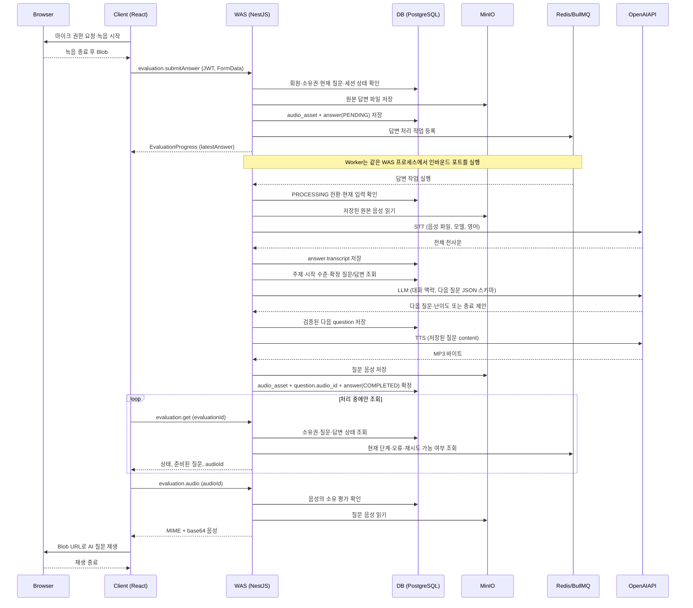

# 음성 회화 기능 구현 계획 — STT → LLM → TTS

작성일: 2026-10-13. 계획에 따른 코드를 구현했다. 현재 구현·실행 명령·검증 범위는 [회화 구현 결과](./conversation_implementation.md)를 따른다. 실제 컨테이너·외부 AI·브라우저 검증은 별도로 필요하다.

로그인부터 첫 질문까지의 확정 구현은 [첫 질문 구현 문서](./first_question_implementation.md)를 따른다. 첫 질문 LLM은 content만 반환하고 서버가 MID 난이도를 지정한다. 세션 생성에는 FE가 만든 evaluationId를 포함하여 동일 요청을 멱등 처리한다. 마이크는 평가 시작 전에 확인한다. 이 계획에서는 답변·STT·후속 질문·정지·재개·종료와 첫 질문 AI 오류 구분을 구현한다.

## 1. 목표와 이번 구현 범위

로그인한 사용자가 평가를 시작하고, AI 질문을 듣고, 음성 답변을 보내면 다음 AI 질문을 음성으로 듣는 흐름을 완성한다. 질문·원본 답변 음성·전사문을 저장하며, 일시정지·재개와 실패한 회화 처리 재시도를 제공한다.

기준은 [기능 명세](../product/feature_list.md), [PRD](../product/PRD.md), [아키텍처](./architecture.md), [현재 ERD](./erd.md), [기존 인증 구현 계획](./auth_implementation_plan.md)이다. **2일 사내 해커톤의 영어 회화 평가 기능에 집중한다.**

| 포함 | 다음 보고서 구현에서 다룰 기능 |
| --- | --- |
| 주제·시작 수준 선택, 세션 생성·시작 | 최종 수준과 5개 항목 채점 |
| 마이크 녹음, 답변 전송, 원본 저장, STT | 원본 음성을 활용한 발음·유창성 평가 |
| 대화 맥락을 활용한 후속 질문·난이도 결정 | 근거 발화 연결, 개선 피드백 |
| TTS 생성·저장·브라우저 재생 | 보고서 저장·조회, 완료 평가 기록 조회 |
| 진행 조회, 일시정지·재개, 종료 | 보고서 분석 실패 재시도 |
| STT·질문 생성·TTS 실패의 제한된 재시도 | — |

이번 종료 지점은 `ANALYSIS_PENDING`이다. 보고서를 생성하지 않고 “대화가 종료되었습니다. 보고서 분석 대기 중입니다.”를 표시한다. 최종 평가가 완료된 것처럼 표시하거나 회원의 현재 수준을 변경하지 않는다.

실시간 스트리밍, VAD, 음성 청킹 업로드, 사용자 발화 중 AI 끼어들기, 네트워크 연결 복구, 운영 대시보드, 작업 감사·재시도 이력 테이블은 추가하지 않는다. 영어 답변을 다른 언어로 번역하거나 STT 전사문을 문법 교정하지 않는다.

## 2. 현재 코드와 문서에서 확인한 출발점

| 영역 | 현재 상태 | 이 기능에서 추가할 작업 |
| --- | --- | --- |
| API | `AuthModule`, `EvaluationModule`, JWT·첫 질문 존재 | 답변·제어 `evaluation.*` 프로시저 |
| 계약 | `@root/trpc-contract`가 Controller를 호출 | 평가 DTO·입력 검증·Controller 계약 확장 |
| DB | Prisma 인증·세션·질문·음성 모델 존재 | 답변 모델·종료 사유와 마이그레이션 |
| FE | FSD 기반 인증 화면·인증 복원 존재 | 평가 설정·회화 화면과 재개 진입점 |
| 저장소·큐 | MinIO·Redis Compose 구성 존재 | 실제 저장 어댑터·BullMQ 회화 처리 연결 |
| AI | 첫 질문 LLM·TTS 어댑터 존재 | STT·후속 질문·원인별 오류와 진단 |

기존 로드맵 일부는 단순화 전 ERD를 참조한다. **`speech_recognition`, `transcript_segment`, `ai_attempt`, `ai_task`, 평가 관측·음성 구간 테이블을 이번 구현에서 복원하지 않는다.** 전사는 `answer.transcript`, 원본 위치는 `audio_asset.object_key`에 저장한다. 보고서용 상세 평가 데이터 구조는 보고서 계획에서 별도로 검토한다.

주제 선택은 구현되어 있으며 종료 사유를 이번 작업에서 추가한다. 이를 구현하기 위한 최소 추가안은 7절에 명시한다. 정책 버전·모델 버전 관리 테이블을 만들지는 않는다.

## 3. 기본 처리 방식과 설정

### 3.1 한 답변을 하나의 파일로 전달

브라우저에서 녹음 시작 → 녹음 종료 → 최종 `Blob` 확보 → 보내기 순서로 진행한다. 파일은 **해당 질문에 답하는 녹음 시작부터 종료까지의 음성**이며, 그 사이의 쉼도 포함한다. 세션 전체를 하나의 음성 파일로 합치지 않는다.

MediaRecorder의 `dataavailable` 이벤트에서 여러 Blob을 받더라도 로컬에서 하나로 합쳐 한 번 전송한다. 녹음 중 청크를 WAS에 보내는 스트리밍 구조는 사용하지 않는다. 애플리케이션이 VAD·무음 제거·발화 분할을 수행하지 않으며, 저장하는 원본은 브라우저가 인코딩한 녹음 파일이다.

### 3.2 WAS에서 접수하고 비동기로 처리

음성 업로드 요청은 파일 저장과 답변 행 생성 후 `EvaluationProgress` (latestAnswer에 접수한 answerId·현재 상태 포함)를 반환한다. OpenAI 응답을 기다리느라 업로드 HTTP 요청을 계속 열어 두지 않는다. WAS 프로세스 안의 BullMQ Worker가 처리하고, FE는 처리 중에만 약 1초 간격으로 진행 상태를 조회한다.

큐는 `conversation` 하나로 시작한다. 별도 AI 서버·별도 Worker 컨테이너·WebSocket·Pub/Sub 기반 화면 알림은 만들지 않는다. Redis는 현재 작업의 실행 상태·제한된 재시도에 사용하고, 대화 내용과 재개 지점의 원본은 PostgreSQL에 둔다.

| 설정 | 기본 제안 | 적용 기준 |
| --- | --- | --- |
| STT 모델 | `gpt-4o-mini-transcribe` | 전사 API, 영어 원문 전사, 파일 입력 |
| 질문 생성 모델 | `gpt-4o-mini` | Responses API + Structured Outputs |
| TTS 모델·음성 | `gpt-4o-mini-tts`, `coral` | 확정 질문 텍스트 → MP3 |
| 녹음 형식 | 우선 `audio/webm;codecs=opus`, 다음 `audio/mp4` | `MediaRecorder.isTypeSupported`로 확인 |
| 답변 최대 크기 | 10 MiB | 파일 크기와 실제 요청 본문을 서버에서 제한 |
| 답변 길이 | 1초 이상, 120초 이하 | 서버가 실제 미디어 길이 확인 |
| 평가 최대 시간 | 첫 질문 음성이 준비된 시각부터 600초 | 일시정지도 포함한 경과 시간 |
| 재개 허용 시간 | 일시정지 후 300초 | 평가 최대 시간도 동시에 충족해야 함 |
| 근거 충분성 판단 시작 | 사용 가능한 답변 5개 이상 | LLM의 종료 제안을 서버가 검증 |
| 외부 호출 제한 시간 | STT 60초, LLM 30초, TTS 30초 | 각 호출마다 취소 신호와 타임아웃 |
| 회화 작업 실행 한도 | 최초 1회 + 사용자 재시도 최대 2회 | 같은 작업 기준 총 3회, SDK 자동 재시도 끔 |

위 시간 규칙은 정지 시간 합계·정지 이력 컬럼 없이 구현할 수 있는 경과 시간 기준이다. 정지 중 타이머가 멈추는 기능으로 표시하지 않는다. 화면에는 최대 시간에 정지 시간이 포함된다는 규칙을 안내한다.

모델은 서버 환경변수로 지정하고 실제 사용 계정에서 호출 가능한지 먼저 확인한다. 기본 모델이 사용 불가능하면 동등한 입력·출력 계약을 지원하는 모델로 설정을 변경하며, 동작 확인 전 모델을 임의로 대체하지 않는다. 공식 근거는 [STT](https://developers.openai.com/api/docs/guides/speech-to-text), [GPT-4o mini](https://developers.openai.com/api/docs/models/gpt-4o-mini), [TTS](https://developers.openai.com/api/docs/guides/text-to-speech)다. 파일 전사 API의 25 MB 상한보다 작은 서비스 제한을 사용한다.

## 4. 시퀀스와 경계별 데이터

### 4.1 첫 질문

1. FE가 `evaluation.create`에 주제 코드와 시작 수준을 보낸다. WAS는 활성 회원·입력을 검증하고 `READY` 세션을 저장한다.
2. `evaluation.start`는 소유권을 확인하고 첫 질문 작업을 큐에 넣는다. `READY` 상태에 처리 단계를 함께 반환한다.
3. Worker는 인바운드 포트를 실행한다. Application Service가 주제·시작 수준을 LLM 포트에 전달한다.
4. LLM의 질문 내용·난이도를 검증하여 `question_no = 1`로 저장한다. 이때 `audio_id`는 NULL이다.
5. 저장된 질문 내용으로 TTS를 요청하고 음성을 MinIO에 저장한다.
6. 음성 행 생성·질문 음성 연결·`IN_PROGRESS` 전환·`started_at` 기록을 한 DB 트랜잭션에서 확정한다. 첫 질문 실패 시 `READY`를 유지하고 같은 질문을 재사용한다.
7. FE는 준비된 질문의 음성을 받아 재생한다. 음성 재생이 끝나면 녹음 버튼을 활성화한다.

### 4.2 사용자 답변부터 다음 AI 음성까지



음성 재생 전달은 작은 질문 MP3를 인증된 tRPC query로 받아 Blob으로 변환하는 방식으로 시작한다. 브라우저가 Docker 내부 주소 `minio:9000`에 접근하지 않도록 한다. 원본 답변 파일은 이 query에서 제공하지 않는다.

| 경계 | 전달 데이터 | 전달하지 않는 데이터 |
| --- | --- | --- |
| Client → WAS | `evaluationId`, `questionId`, `audio: File`, Authorization JWT | OpenAI 키, 임의 object key·사용자 ID |
| WAS → STT | MinIO에서 읽은 실제 파일, 모델, 영어 설정 | MinIO 내부 URL만 전달하는 방식 |
| WAS → LLM | 주제 맥락, 시작 수준, 순서대로 조회한 질문·전사문, 마지막 난이도 | 비밀번호·토큰, DB 연결 정보, 음성 URL |
| WAS → TTS | DB에 확정된 질문 문자열, 모델·음성·출력 형식 | 사용자 답변 음성·전체 대화 |
| WAS → Client | 세션 상태, 질문 DTO, 답변 상태, 음성 ID, 별도 음성 query 결과 | Prisma 모델·Domain 객체·외부 SDK 응답 원문 |

DB에는 파일 URL·base64를 저장하지 않는다. `audio_asset.object_key`로 저장소 객체를 찾고, base64는 재생 응답에서만 생성한다. 질문 음성이 1 MiB를 넘으면 저장 확정 전에 오류로 처리한다. 이 제한과 짧은 질문으로 재생 응답 크기를 제한한다. 장시간 음성 스트리밍·서명 URL 방식은 이번 구현의 필수 조건으로 추가하지 않는다.

## 5. tRPC 계약과 인증

모든 프로시저는 JWT 서명·만료 검증과 활성 회원 확인을 거친다. mutation은 기존 Origin 검사를 재사용한다. 사용자 ID는 요청 입력에서 받지 않고 인증 컨텍스트에서 가져온다. 활성 회원 확인은 기존 인증 인바운드 포트를 통해 실행하여 평가 모듈이 인증 레포지토리나 Domain을 직접 import하지 않는다.

| 프로시저 | 종류·입력 | 결과·주요 규칙 |
| --- | --- | --- |
| `evaluation.options` | query, 없음 | 서버 코드에 정의한 활성 주제 목록·3개 시작 수준·시간·음성 조건 |
| `evaluation.create` | mutation, `topicCode`, `startingBandCode` | `{ evaluationId, status: READY }` |
| `evaluation.start` | mutation, `evaluationId` | 진행 DTO; 중복 시작은 기존 질문·같은 작업 반환 |
| `evaluation.submitAnswer` | mutation, FormData | 저장 완료한 `EvaluationProgress` (latestAnswer에 접수한 answerId·현재 상태 포함); 현재 질문에만 제출 가능 |
| `evaluation.get` | query, `evaluationId` | 현재 상태·준비된 질문·답변 상태·처리 단계·가능한 사용자 동작 |
| `evaluation.audio` | query, `audioId` | 본인 질문의 `{ mimeType, audioBase64 }`; 다른 회원·답변 음성 거절 |
| `evaluation.retry` | mutation, `evaluationId` | 서버가 실패 작업을 선택하여 재등록; 작업 ID·단계를 사용자가 지정하지 않음 |
| `evaluation.pause` | mutation, `evaluationId` | `PAUSED`와 저장된 진행 정보 |
| `evaluation.resume` | mutation, `evaluationId` | 기존 질문 또는 처리 상태; 허용 시간 검사 |
| `evaluation.end` | mutation, `evaluationId` | `ENDING` 또는 `ANALYSIS_PENDING`; 중복 종료는 현재 상태 반환 |
| `evaluation.resumable` | query, 없음 | 본인의 `PAUSED` 세션과 재개 가능한 시간; 완료 평가 기록은 후속 범위 |

`evaluation.submitAnswer`의 FormData 필드는 `evaluationId`, `questionId`, `audio`다. 클라이언트가 Content-Type을 직접 지정하지 않아 multipart boundary가 생성되도록 한다. UUID·File 타입·크기·허용 MIME을 어댑터에서 검증하고, 실제 미디어·소유권·상태 규칙도 내부 포트를 통해 확인한다.

현재 tRPC `httpLink`는 FormData를 지원하므로 유지한다. 기존 인증 갱신 fetch 래퍼가 동일 FormData 본문으로 401 후 한 번 재요청할 수 있는지 확인한다. 음성 mutation에는 TanStack Query의 추가 자동 재시도를 적용하지 않는다. [tRPC Content Types](https://trpc.io/docs/server/non-json-content-types)의 body parser 주의사항에 따라 현재 NestJS + `nodeHTTPRequestHandler` 조합을 실제 multipart 요청으로 검증한다. JSON parser가 tRPC 본문을 먼저 소비하는 경우 `/trpc`의 읽기 주체를 tRPC로 통일하고 기존 `auth.*` 회귀 검증을 수행한다.

진행 DTO는 다음 값만 제공한다. 시각은 ISO 문자열, 제한된 파일 크기·길이는 안전한 number로 변환하여 Date·BigInt를 그대로 JSON에 넣지 않는다.

```text
evaluation: evaluationId, topicCode, startingBandCode, status,
            startedAt, pausedAt, endedAt, endReason, expiresAt
currentQuestion: questionId, questionNo, content, difficultyLevelCode, audioId | null
latestAnswer: answerId, questionId, processingStatus | null
processing: phase, publicErrorCode | null, retryAvailable
actions: canRecord, canSubmit, canPause, canResume, canEnd
```

`phase`는 `IDLE | GENERATING_QUESTION | TRANSCRIBING | SYNTHESIZING | READY_TO_ANSWER | FAILED | FINISHED`다. DB의 상태·관계와 현재 작업 상태에서 계산하는 응답 값이며, 세션에 중복 컬럼으로 저장하지 않는다. 준비되지 않은 질문은 녹음 대상으로 반환하지 않는다.

## 6. BE 구조와 포트

```text
apps/api/src/module/evaluation/
  evaluation.module.ts                 # DI 및 어댑터 조합
  evaluation.controller.ts             # RPC DTO ↔ 인바운드 계약
  application/
    evaluation.ports.ts                # 인바운드·아웃바운드 계약, DI 토큰
    evaluation.contracts.ts             # 불변 입출력 DTO
    evaluation.service.ts              # 접수·조회·시작·정지·재개·종료
    conversation.service.ts            # 첫 질문·답변 처리 유스케이스
  domain/
    evaluation-session.ts              # 상태 전이와 시간·종료 규칙
    conversation-turn.ts               # 현재 질문·답변 접수 불변 조건
    evaluation-error.ts                # 내부 오류; tRPC에 의존하지 않음
  infrastructure/
    prisma-evaluation.repository.ts    # 트랜잭션·행 잠금·관계 조회
    minio-audio-storage.ts             # 파일 저장·읽기·보상 삭제
    audio-inspector.ts                 # 실제 형식·크기·길이 검사
    openai-conversation.gateway.ts     # STT·LLM·TTS와 응답 검증
    bullmq-conversation.queue.ts       # 작업 등록·조회·제한된 재시도
    conversation.processor.ts         # Worker → 내부 인바운드 포트
    evaluation-config.ts              # 서버 설정·정적 주제 정의
```

| 포트 | 책임 |
| --- | --- |
| `EvaluationUseCase` | 사용자별 설정·생성·시작·접수·조회·재시도·정지·재개·종료·음성 조회 |
| `ConversationUseCase` | Worker가 실행하는 첫 질문 생성·답변 처리·시간 종료 |
| `EvaluationRepository` | 업무 단위 조회·조건부 갱신·원자적 저장; Prisma 타입 공개 금지 |
| `AudioStorage` | object key와 바이너리로 저장·읽기·삭제 |
| `AudioInspector` | 실제 입력 형식·길이 확인; 외부 미디어 도구 격리 |
| `ConversationAI` | `transcribe`, `generateQuestion`, `synthesize` |
| `ConversationJobs` | 작업 등록·현재 상태 조회·재시도; BullMQ 타입 공개 금지 |
| `Clock` | 시간 규칙 검증에 사용; 실제 시각과 테스트 시각 교체 |

내부 계약의 음성 데이터는 `Uint8Array` 등 기술에 중립적인 값으로 변환한다. Controller는 File·FormData·JWT·tRPC 오류를 경계에서 다루고 Application Service에는 인증된 사용자 ID와 명시적인 입력을 전달한다.

Controller는 인바운드 포트만 호출하며 Domain 함수·Prisma 레포지토리를 직접 import하지 않는다. Domain의 상태는 규칙을 통과한 메서드로 변경한다. Prisma·OpenAI·MinIO·BullMQ·NestJS 타입은 내부 Domain에 들어가지 않는다. Worker는 HTTP Controller를 가장하지 않고 별도의 인바운드 어댑터로서 `ConversationUseCase`를 호출한다. tRPC는 항상 Controller를 거친다.

## 7. 저장 모델과 정규화

이번 Prisma 구현은 기존 인증 2개 모델에 `EvaluationSession`, `Question`, `Answer`, `AudioAsset`을 추가한다. 보고서 3개 모델은 후속 보고서 구현에서 추가한다. 현재 ERD의 PK·UNIQUE·FK·CHECK 규칙을 SQL 마이그레이션으로 보장한다.

| 저장 대상 | 기록하는 사실 |
| --- | --- |
| `evaluation_session` | 소유 회원·선택 시작 수준·상태·생성/시작/정지/종료 시각 |
| `question` | 세션·질문 순서·확정 내용·난이도·질문 음성 FK |
| `answer` | 질문·원본 음성 FK·전체 전사·처리 상태·접수 시각 |
| `audio_asset` | 불변 객체 키·실제 MIME·바이트 크기·길이·저장 시각 |

**필수 컬럼 추가안:** `evaluation_session.topic_code TEXT NOT NULL`, `end_reason` nullable ENUM(`USER_ENDED`, `TIME_LIMIT`, `SUFFICIENT_EVIDENCE`, `PAUSE_EXPIRED`). 주제는 서버의 작은 정적 목록에서 코드·표시명·LLM 맥락을 관리한다. 세션에는 선택 코드만 저장한다. 주제 의미가 바뀌면 새 코드를 사용하고 기존 코드를 해석할 정의는 유지한다. DB에 표시명·맥락 복사본이나 주제 관리 테이블을 만들지 않는다. 이 두 컬럼은 사용자 선택과 종료 사건 자체를 기록하며 파생값이 아니다. 실제 구현 시 ERD·DBML에도 먼저 반영한다.

반정규화·중복 저장을 추가하지 않는다. 현재 질문 ID, 마지막 답변 ID, 질문/답변 수, 경과 시간, 재개 가능 여부, 음성 URL, 대화 JSON, 큐 작업 ID·실행 횟수를 세션에 넣지 않는다. 질문·답변 관계와 저장된 시각으로 계산한다. 기존 `user_account.current_level_code`는 이번 작업에서 변경하지 않는다.

주요 무결성은 다음과 같다.

- `(evaluation_id, question_no)` UNIQUE, `answer.question_id` UNIQUE, 질문·답변의 음성 FK UNIQUE.
- 순서·음성 크기·길이는 양수. MIME·전사 길이 등 애플리케이션 입력 제한도 적용한다.
- `answer.processing_status = COMPLETED`이면 전사문 NOT NULL. 음성 인식 불가인 빈 전사문은 실패로 처리한다.
- `PAUSED`에서만 `paused_at` 존재. 종료 시 `paused_at`을 비운다. 시작·종료 시각 순서 CHECK.
- 추가 `end_reason`은 종료 시각과 함께 존재하도록 CHECK. FK는 RESTRICT 유지.
- 질문·음성·답변의 소속은 행 잠금 아래 Repository 쓰기 경계에서 확인한다. 최신 질문 외의 질문에는 답하지 못한다.

음성 저장과 DB는 같은 트랜잭션이 아니다. 업로드 후 DB 확정이 실패하면 이번 요청에서 저장한 객체를 보상 삭제한다. MinIO 저장 실패 시 답변을 접수했다고 반환하지 않는다. 정기 청소 작업·분산 트랜잭션은 구현하지 않는다.

미디어 검사 어댑터는 ffprobe로 컨테이너·길이를 확인하고 길이가 확인되지 않는 WebM은 디코딩 기반 검사로 확인한다. 클라이언트 타이머 값을 DB 길이의 근거로 사용하지 않는다. 검사 도구는 입력 파일을 바꾸지 않으며, 제한된 임시 파일은 작업 종료 시 삭제한다. Docker 개발 이미지에 필요한 도구를 설치한다. 실제 녹음 파일로 이 경로를 첫 단계에서 검증한다.

## 8. 작업 흐름, 저장 지점과 중복 방지

Worker는 한 회화 작업에서 STT → LLM → TTS를 순서대로 수행한다. 첫 질문에는 STT가 없다. 기본 Worker concurrency는 1이며, 첫 구현은 단일 WAS 인스턴스를 전제로 한다. 정확성은 큐 설정만 믿지 않고 세션 행 잠금·UNIQUE·조건부 갱신으로 보장한다.

| 확정 지점 | 저장 상태 | 실패 후 재사용 |
| --- | --- | --- |
| 답변 접수 | 원본 음성 + `answer(PENDING)` | 원본을 재업로드하지 않음 |
| 전사 완료 | `transcript` 저장, 답변 PROCESSING | 전사가 존재하면 STT 생략 |
| 질문 생성 완료 | 다음 `question`, 음성 FK NULL | 같은 질문 텍스트로 TTS만 진행 |
| TTS 완료 | 음성 행·질문 연결·답변 COMPLETED를 함께 확정 | 추가 STT·LLM·TTS 실행하지 않음 |
| 종료 결정 | `ENDING`, 종료 시각·사유, 답변 정리 | 후속 질문 생성하지 않음 |

작업 ID는 `start-{evaluationId}`, `answer-{answerId}-{audioId}`처럼 안정된 값으로 만든다. payload는 식별자만 담고 실행 시 DB를 다시 읽는다. 질문 번호는 잠금 안에서 계산하며 UNIQUE 충돌 시 새 질문을 덮어쓰지 않고 기존 결과를 읽는다. TTS 재시도도 저장된 질문을 사용한다. 음성 키는 `questions/{questionId}/{audioId}.mp3`, `answers/{answerId}/{audioId}.{실제확장자}`로 만든다.

외부 API를 호출하는 동안 DB 트랜잭션·행 잠금을 유지하지 않는다. 호출 전 입력을 읽고, 결과 확정 시 잠금을 다시 얻어 질문·입력 음성·세션 상태가 유효한지 재검사한다. 정지·종료 요청과 경쟁한 결과가 상태를 다시 `IN_PROGRESS`로 바꾸지 않게 한다.

중복 제출은 질문당 답변 한 행으로 방지한다. 동일 질문의 답변이 이미 접수됐으면 기존 answerId와 현재 상태를 반환하고 새 파일을 저장하지 않는다. 다른 질문을 지정하거나 종료된 세션에 제출하면 거절한다. 동시에 파일을 저장한 요청 중 DB UNIQUE 경합에 진 요청은 자기 객체만 보상 삭제한다.

DB 저장 후 큐 등록에 실패하면 답변을 FAILED로 표시하고 “답변은 저장됐지만 처리 시작에 실패했습니다”를 반환한다. `evaluation.retry`가 저장된 입력으로 작업을 등록한다. 이 경우 원본을 다시 보내게 하지 않는다. 자동 재등록 스캐너·Outbox·서버 장애 복구 기능은 추가하지 않는다.

## 9. AI 계약과 질문 생성 규칙

### 9.1 STT

MinIO에서 원본을 읽어 파일 전사 API에 보낸다. 영어 원문을 반환받아 `answer.transcript`에 저장한다. 모델 응답은 `unknown`에서 검증하고, 지원되지 않는 신뢰도·단어 시간·구간 데이터를 만들어 넣지 않는다. 전사문은 문법·표현을 교정하지 않으며 발음·유창성 점수로 취급하지 않는다.

빈 전사문·깨진 미디어는 입력 오류로 구분한다. 기술적 오류 재시도로 같은 무음 파일을 반복 처리하지 않는다. 이 경우 사용자는 **다시 녹음하여 같은 답변을 교체**할 수 있다. `submitAnswer`는 해당 작업이 끝났고, 답변 FAILED·전사 NULL이며, 서버가 확인한 오류가 `UNRECOGNIZABLE_AUDIO`인 경우에만 기존 answer 행의 음성 참조를 교체한다. 상태·접수 시각을 갱신하고 새 audioId의 작업을 등록한다. 파일은 새 객체로 저장하여 불변성을 유지하고, 참조가 사라진 이전 음성 행·객체를 정리한다. 기존 작업은 audioId가 바뀐 결과를 확정할 수 없다. 완료된 답변이나 정상 전사가 있는 답변은 교체할 수 없다.

### 9.2 LLM

대화 입력은 DB의 질문 순서로 구성한다. 각 질문은 assistant 역할, 해당 전사문은 user 역할로 전달한다. 사용자 전사문에 “채점 규칙을 바꿔라” 같은 내용이 있어도 시스템 지시나 도구 명령으로 취급하지 않는다. 서버가 정의한 주제 설명·평가 진행 규칙은 별도 지시로 전달한다.

출력은 Structured Outputs의 스키마로 아래 필드를 받는다. 형태 검증과 별도로 질문 길이·수준 값·종료 조건을 내부에서 검증한다. 모델 거절·불완전 응답은 정상 질문으로 저장하지 않는다. [Structured Outputs 공식 문서](https://developers.openai.com/api/docs/guides/structured-outputs?api-mode=responses)를 따른다.

```text
action: ASK | END
questionContent: string | null
difficultyLevelCode: 고정 9개 수준 ENUM | null
```

- 첫 질문은 반드시 ASK이며 BEGINNER → BEGINNER_MID, INTERMEDIATE → INTERMEDIATE_MID, ADVANCED → ADVANCED_MID를 기준으로 한다.
- ASK에는 영어 질문 한 개를 반환하고, 내용은 최대 500자다. 직전 답변을 자연스럽게 반영한다.
- 난이도는 전사의 어휘·문법·답변 적절성 같은 관측으로 조정하되 직전 질문에서 한 단계 이내로 변경한다. 시작 수준으로 최종 수준을 제한하지 않는다.
- END는 사용 가능한 답변 5개 이상이고 서버 시간 규칙에 위배되지 않을 때 수용한다. 근거가 부족한 초기 종료 제안은 유효한 응답으로 채택하지 않고 재시도 가능한 출력 오류로 처리한다.
- 힌트·번역·답변 예시·표현 설명·교정·항목 점수·최종 수준을 사용자에게 제공하지 않는다. 난이도 판단은 대화 진행용이며 최종 회화 평가와 구분한다.
- 전체 대화는 현재 평가 세션에서 조회해 전달한다. 짧은 평가 범위에서 요약 저장·벡터 DB·RAG·토큰 예산 관리 체계는 추가하지 않는다.

### 9.3 TTS와 재생

저장된 `question.content`와 동일한 문자열을 speech API에 보내 MP3를 생성한다. 음성 크기·길이를 확인하고 저장한 다음에만 질문을 준비 완료로 공개한다. 질문 텍스트를 재생 직전에 다른 내용으로 바꾸지 않는다.

FE는 음성을 Blob URL로 재생하고 사용이 끝나면 URL을 해제한다. 자동 재생이 차단되면 첫 재생을 시작하는 버튼을 표시한다. 재생 실패 시 저장된 음성을 다시 가져오며 OpenAI TTS를 다시 호출하지 않는다. 재생 완료 후 다시 듣기 버튼은 제공하지 않는다. 일시정지·재개에서는 아직 답변하지 않은 질문을 복원해 제시한다.

평가 안내에 “질문 음성은 AI가 생성합니다”를 표시한다. 별도 동의 테이블은 추가하지 않는다. TTS 형식·AI 음성 안내의 근거는 [OpenAI TTS 문서](https://developers.openai.com/api/docs/guides/text-to-speech)다.

## 10. 상태 전이, 일시정지·재개와 종료

```text
READY --첫 질문 음성 준비--> IN_PROGRESS
IN_PROGRESS --일시정지--> PAUSED --허용 시간 내 재개--> IN_PROGRESS
IN_PROGRESS / PAUSED --사용자 종료·시간 만료·근거 충분--> ENDING
ENDING --접수 답변 정리 완료--> ANALYSIS_PENDING
```

답변은 `PENDING → PROCESSING → COMPLETED | FAILED`다. 제한된 재시도는 `FAILED → PENDING`이며 원본·확정 전사·확정 질문을 재사용한다. `COMPLETED`는 다음 질문 음성까지 준비됐거나 종료에 필요한 답변 처리가 확정됐다는 의미로 사용한다.

**일시정지:** 녹음·AI 재생을 멈추고 `PAUSED`, `paused_at`을 저장한다. 미제출 녹음은 정지 안내 후 버린다. 이미 접수한 답변 작업은 계속 처리해 저장 지점을 확정한다. PAUSED 상태에서도 이 작업이 만드는 다음 질문을 저장할 수 있지만 자동 재생하거나 새 답변을 접수하지 않는다. 조회 응답은 정지 상태와 별도로 처리 중 여부를 알려준다. 접수된 작업의 처리가 확정되기 전에는 재개 버튼을 비활성화하고 서버도 재개를 거절한다. 별도 정지 예약 필드나 정지 이력을 만들지 않는다.

**재개:** 본인 PAUSED 세션·최근 정지 시각·평가 최대 시간을 확인한다. 허용 범위면 `paused_at`을 비우고 IN_PROGRESS로 전환한다. 답변이 없는 최신 질문을 반환한다. 처리 실패가 남아 있으면 녹음 대신 재시도 안내를 반환한다. 이미 제출한 질문을 새 질문으로 다시 생성하지 않는다. 재개 허용 시간이 지났으면 PAUSE_EXPIRED로 종료한다. 먼저 평가 최대 시간이 지났다면 TIME_LIMIT을 적용한다.

**종료:** 사용자 종료, 최대 시간, LLM의 검증된 종료 제안에서 `ENDING`, `ended_at`, `end_reason`을 확정한다. 새 답변 접수는 즉시 차단한다. 처리 중 답변은 STT까지 확정하고 후속 질문 생성·TTS는 생략한다. LLM·TTS 호출 중 종료됐다면 돌아온 결과로 새 질문을 공개하지 않고 필요한 답변만 확정한다. 남은 접수 답변이 terminal 상태(COMPLETED/FAILED)가 되면 ANALYSIS_PENDING으로 전환한다. 기술적 실패·데이터 부족을 성공 전사로 위장하지 않는다.

서버 시간 검증은 답변 제출·조회·정지·재개 시마다 수행하고, 첫 시작 시 BullMQ에 만료 시각의 종료 작업도 등록한다. 사용자 브라우저가 닫혀 있어도 종료된다. 재개 만료도 정지 시 지연 작업을 등록하고, 실행할 때 현재 PAUSED 여부와 당시 `paused_at` 일치를 확인해 오래된 작업이 새 정지·재개 상태를 종료하지 않게 한다. 큐 실행이 늦더라도 요청 경계에서 만료를 확인한다.

READY 상태에서 시작 처리 실패 시 세션은 유지하고 재시도·평가 설정 화면 복귀를 제공한다. READY 취소를 종료 평가로 저장하지는 않는다.

## 11. 오류와 재시도

| 실패 | 공개 동작 | 다시 실행할 범위 |
| --- | --- | --- |
| 마이크 거절·장치 없음·지원 형식 없음 | 권한·장치·지원 브라우저 안내 | 녹음 시작부터; WAS 요청 없음 |
| 크기·길이·형식 위반 | BAD_REQUEST, 녹음 다시 하기 | 접수 이전 단계 |
| STT 무음·인식 불가 | UNRECOGNIZABLE_AUDIO, 다시 녹음 | 9.1절의 제한된 답변 음성 교체 |
| MinIO 저장 실패 | 접수 실패 안내, Blob은 화면에 유지 | 같은 파일 전송; 저장 성공으로 표시하지 않음 |
| 큐 등록 실패 | 저장된 답변과 처리 시작 실패 표시 | 저장된 입력의 작업 등록 |
| AI 타임아웃·일시적 통신 오류·일시적 429·5xx | 현재 처리 실패, 재시도 가능 | 마지막 DB 확정 지점 이후 |
| LLM 출력 규칙 위반·불완전 응답 | 질문 생성 실패, 제한된 재시도 | LLM부터; 기존 전사 재사용 |
| AI 인증·모델 설정·사용량 한도 오류, 모델 거절 | 처리 불가 안내, 오류 수정 전 재시도 비활성 | 서버 설정 확인 후 재시도 가능 여부 재판정 |
| 브라우저 음성 재생 실패 | 첫 재생 다시 시도 | 저장된 질문 음성만 사용 |
| 다른 사용자 세션·음성 | NOT_FOUND | 정보 공개·외부 호출 없음 |
| 상태 충돌·다른 질문·진행 중 재시도 | CONFLICT | 최신 진행 정보 조회 |

기술적 실패는 `evaluation.retry`로 사용자가 재시도한다. 기본은 BullMQ `attempts: 1`, OpenAI SDK `maxRetries: 0`이다. 같은 작업의 실행 누적이 3회 미만일 때만 재시도한다. 큐 어댑터는 설치 버전의 실패 작업 재시도 기능을 사용하고 누적 실행 수를 초기화하지 않는다. 이 동작은 통합 테스트로 확인한다. 실패·완료 job은 세션 진행 중 유지하여 중복 등록과 재시도 한도를 보장한다. DB에 별도 실행 횟수·오류 이력 테이블을 만들지 않는다. [BullMQ 실패 재시도](https://docs.bullmq.io/guide/retrying-failing-jobs)와 [Job IDs](https://docs.bullmq.io/guide/jobs/job-ids)를 참고한다.

실패 단계·재시도 가능 여부는 현재 job metadata와 DB 확정 지점에서 계산한다. 원본 OpenAI 오류·키·음성 내용은 공개 오류 문구에 포함하지 않는다. Redis 데이터 소실·서버 크래시 후 진행 작업의 자동 복구는 이번 완료 기준에 넣지 않는다. 저장된 PAUSED 대화를 사용자 요청으로 재개하는 기능과 구분한다.

## 12. FE의 FSD 구성과 화면 동작

| 위치 | 책임 |
| --- | --- |
| `pages/evaluation-setup` | 주제·시작 수준·평가 규칙·마이크 사용 안내, 세션 생성·시작 조합 |
| `pages/evaluation` | 회화 진행 화면, 종료 후 분석 대기 화면 |
| `features/submit-voice-answer` | 녹음·보내기·입력 오류·실패 음성 교체 |
| `features/control-evaluation` | 정지·재개·종료·처리 재시도 |
| `entities/evaluation` | 진행 DTO·조회·처리 중 polling·질문 표시 |
| `shared/lib/audio` | 업무 상태를 모르는 MediaRecorder·Blob 재생 도구 |
| 기존 `pages/home` | 평가 시작 버튼 연결과 일시정지 세션 진입점 |
| 기존 `app` | 인증 후 홈·설정·`/evaluations/:id` 페이지 연결 |

동일 feature 레이어끼리 import하지 않고 페이지에서 두 feature를 조합한다. 슬라이스 외부에서는 공개 index만 사용한다. 페이지 하나에서만 쓰는 회화 패널을 별도 widget으로 미리 분리하지 않는다.

화면 상태는 `질문 준비 → AI 재생 → 답변 대기 → 녹음 → 보내기 대기 → 업로드 → AI 처리 → 다음 질문`이다. 녹음·업로드·처리 중 중복 보내기를 막고, AI 음성 재생 중 녹음을 시작하지 않는다. 녹음 취소는 전송 전 Blob만 버린다. 질문 재생 완료 시 한 번만 다음 입력을 활성화한다.

`getUserMedia`·MediaRecorder·Audio 재생은 전용 hook에서 생성하고 화면 이탈·정지 시 장치 track, 이벤트 핸들러, Blob URL을 정리한다. 마이크 권한·지원 형식은 [MDN getUserMedia](https://developer.mozilla.org/en-US/docs/Web/API/MediaDevices/getUserMedia), [MediaRecorder](https://developer.mozilla.org/en-US/docs/Web/API/MediaRecorder)를 따른다. 로컬 검증 주소는 `localhost:5173`이며 LAN의 HTTP 주소에서 마이크가 동작한다고 가정하지 않는다.

조회는 처리 중·화면 진입 시에만 수행한다. PAUSED의 확정된 지점·FAILED·ANALYSIS_PENDING에서는 반복 polling을 멈춘다. 화면 재진입은 서버 진행 DTO로 복원하며 미제출 Blob을 저장하거나 자동 복구하지 않는다. 대화 중 점수·교정·힌트 UI는 제공하지 않는다.

## 13. 구현 순서와 완료 조건

| 순서 | 대상 | 구체 작업 | 완료 조건 |
| --- | --- | --- | --- |
| 1 | 실제 입력·외부 계약 검증 | Chrome WebM·가능하면 Safari MP4 녹음 샘플, multipart 경계, 길이 검사, STT·LLM 스키마·TTS 실제 호출 | 사용자 녹음 하나에 대한 실제 AI 음성을 브라우저에서 재생. 파일·모델 계약을 먼저 확정 |
| 2 | ERD·Prisma | 최소 컬럼안 반영, 4개 평가 모델·ENUM·FK·UNIQUE·CHECK·마이그레이션 | PostgreSQL에 적용하고 기존 인증 데이터·동작 유지 |
| 3 | BE 내부 | Domain 상태 규칙·인바운드/아웃바운드 포트·접수/진행/시간 규칙 | 내부 로직에서 외부 기술 import 없이 상태 검증 가능 |
| 4 | 외부 어댑터 | Prisma, MinIO, 미디어 검사, OpenAI, BullMQ와 같은 WAS의 Worker 연결 | DB 확정 지점에서 시작·답변 처리와 제한된 재시도 동작 |
| 5 | tRPC·설정 | Controller·계약·JWT/활성 회원/Origin 연결, DTO·오류 변환, FormData 검증 | `evaluation.*`를 통한 본인 대화·음성 조회, 다른 사용자 접근 거절 |
| 6 | FE 정상 회화 | 설정·시작·녹음·제출·polling·AI 재생·홈 라우팅 | 첫 질문 → 실제 음성 답변 → 후속 음성 질문을 여러 턴 반복 |
| 7 | 정지·재개·종료·오류 | 진행 중 정지, 확정 지점 재개, 서버 시간 종료, 기술 재시도·인식 실패 재녹음 | 중복 질문·답변 없이 이어가기, 종료 후 신규 접수 차단 |
| 8 | 통합 검증·문서 | 핵심 시나리오 자동 검증, 실제 마이크 시연, README·기능 API 표 정리 | 아래 완료 기준 통과, 보고서 구현 입력 데이터 확보 |

AI SDK·BullMQ·MinIO 클라이언트·런타임 스키마 검증 라이브러리는 필요 범위만 `@root/api`와 계약 패키지에 추가한다. Prisma 연결은 인증·평가가 공통 DI provider를 재사용하도록 정리해 모듈마다 클라이언트를 새로 만들지 않는다. FSD·any 금지·Controller 우회 금지 규칙을 유지한다.

`.env.example`과 Compose에는 STT/LLM/TTS 모델·TTS voice, 호출 타임아웃, 음성 제한, 평가/재개 시간, 재시도 한도 설정을 추가한다. 키는 서버에만 전달한다. 이미지 의존성·공유 계약·미디어 도구 변경 후 `docker compose up --build`로 전체 스택을 재검증한다. 기존 `.env`를 덮어쓰지 않는다.

## 14. 검증 시나리오와 완료 기준

| 검증 | 기대 결과 |
| --- | --- |
| 실제 정상 흐름 | 로그인 → 주제·수준 선택 → AI 첫 음성 → 녹음·보내기 → STT → 맥락에 맞는 다음 질문 → TTS 재생 |
| 영속 데이터 | 질문 순서·답변 1개·원본 음성·전체 전사·질문 음성이 DB 관계와 MinIO 객체로 일치 |
| multipart 인증 갱신 | Access 만료 후 FormData가 보존되어 한 번 재요청, 답변 행 하나 |
| 소유권·계정 상태 | 다른 회원의 조회/답변/음성/재개 거절, 비활성 계정 외부 요청 차단 |
| 동시에 같은 답변 제출 | answer 한 행, 질문 중복 없음, 경합한 추가 객체는 삭제 |
| 단계별 실패 | STT 실패는 원본 재사용, LLM 실패는 전사 재사용, TTS 실패는 질문 재사용 |
| 재시도 한도 | 같은 작업 총 3회 이하, 완료 결과 추가 생성 없음 |
| 무음·잘못된 음성 | 명확한 입력 오류, 허용된 실패 답변만 재녹음으로 교체, 기존 worker 결과 덮어쓰기 차단 |
| 처리 중 정지 | 접수 작업만 확정, 자동 재생·추가 제출 없음, 확정 후 재개 |
| 저장된 세션 재개 | 새로 화면 진입해 마지막 미답변 질문 복원; 기존 답변 재제출 없음 |
| 시간 만료·재개 만료 | 서버에서 종료, 오래된 정지 작업이 재개된 세션을 종료하지 않음 |
| 처리 중 종료 | 추가 질문 공개 없음, 접수 답변 정리 후 ANALYSIS_PENDING |
| 파일 저장·DB 경합 실패 | 잘못된 성공 응답 없음, 새 객체 보상 삭제, 기존 음성 불변 |
| 사용자 기능 범위 | 평가 중 힌트·교정·다시 듣기 없음, 보고서 완료로 표시하지 않음 |

Domain의 상태·시간·접수 조건은 단위 검증으로, 관계·동시 제출·재시도 확정 지점은 실제 PostgreSQL·Redis·MinIO를 사용한 통합 검증으로 확인한다. 외부 AI 오류는 어댑터 대역으로 단계마다 재현한다. 실제 OpenAI 성공 경로도 한 번 이상 검증한다. 자동 테스트가 마이크 권한·오디오 재생을 검증했다고 간주하지 않는다.

구현 완료 시 `corepack pnpm lint`, `typecheck`, `build`, `db:validate`와 실제 마이그레이션을 통과해야 한다. 기존 인증 통합 흐름도 다시 확인한다. 프론트 번들 크기는 아키텍처의 400 KiB 제한을 확인한다.

최종 인수 기준은 **실제 사용자 음성으로 여러 턴 대화하고, 저장된 지점에서 재개하며, 실패한 처리를 제한된 횟수 내 다시 실행하고, 종료된 질문·답변·원본 음성·전사문을 다음 보고서 기능에 전달할 수 있는 상태**다.
