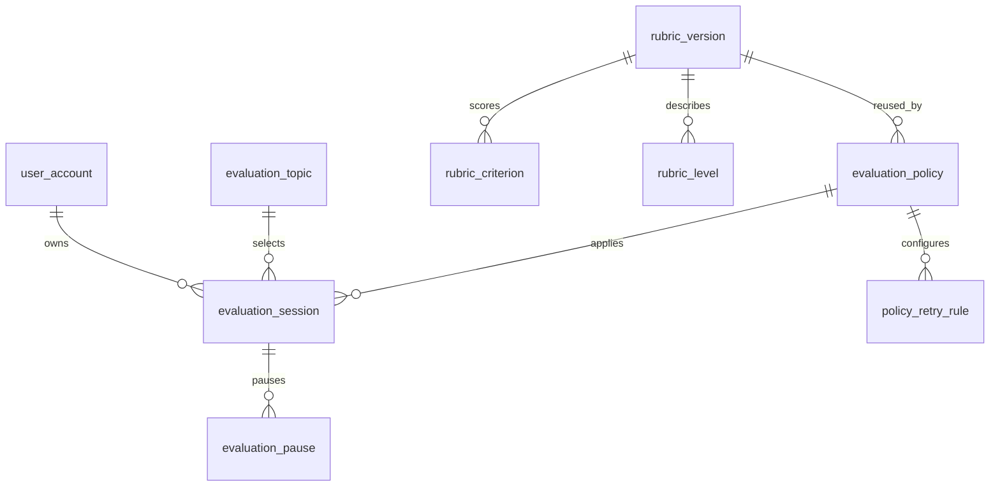
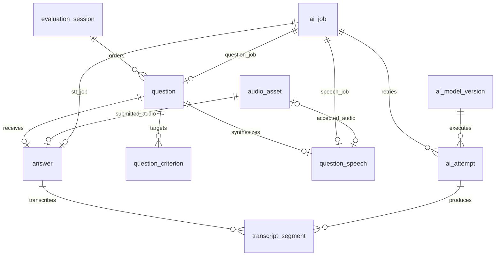
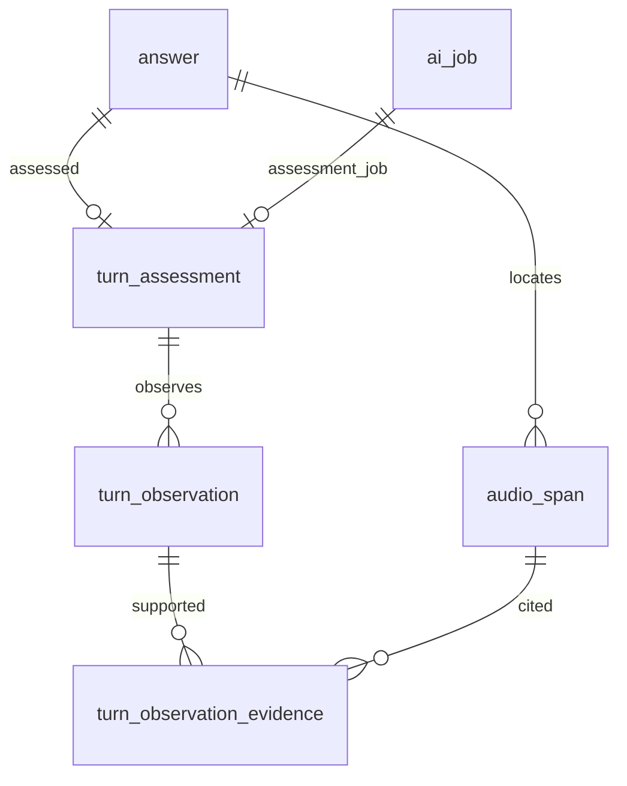
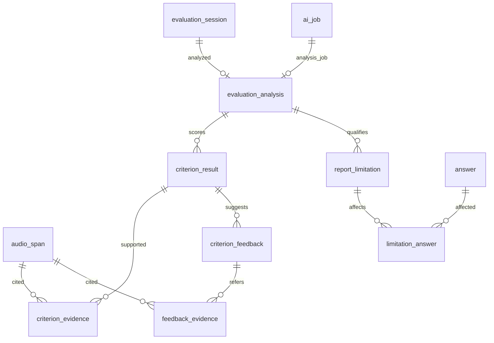

# 영어 회화 평가 플랫폼 — 정규화 ERD

수정일: 2026-10-13. 현재 설계는 **29개 테이블**이다. 2일 해커톤 범위에 맞춰 인증 세션·Refresh Token 테이블을 제외했다. 로그인은 Access JWT로 처리하고 세션 재개와 AI 작업 재시도는 유지한다. 테이블별 판정은 [전체 검토표](./erd_review.md)에 기록한다.

근거: [기능 목록](../product/feature_list.md), [PRD](../product/PRD.md), [아키텍처](./architecture.md). 전체 컬럼·타입·키·관계는 [erd.dbml](./erd.dbml)에 정의한다. DBML은 설계 산출물이며 실제 DB 마이그레이션은 아니다.

## 1. 정규화와 테이블 분리 기준

**반정규화는 금지한다. 정규화를 위해 같은 대상의 속성을 무조건 별도 테이블로 분리하지 않는다.** 다음 기준으로 관계를 정한다.

- 같은 후보키에 종속되는 단일값 속성은 함께 둔다. 평가의 시작·종료 시각, 작업의 입력과 단일 채택 결과가 여기에 해당한다.
- 반복되는 값은 별도 행으로 둔다. 평가 보류 구간, AI 재시도, 전사 구간, 항목 결과가 여기에 해당한다.
- 독립적인 여러 집합은 분리한다. 결과의 근거와 피드백을 한 테이블에 합쳐 근거×피드백 조합을 저장하지 않는다.
- 공유되거나 독립적으로 관리되는 사실은 한 곳에 둔다. 평가 주제, 기준 버전, 모델 버전, 업로드 음성, 재사용되는 근거 구간이 여기에 해당한다.
- 고정 분류·표시명만을 위한 테이블은 만들지 않는다. 평가 항목과 수준은 ENUM 계약, 표시명과 수준 매핑은 코드에서 관리한다.
- 하위 행에 JOIN으로 알 수 있는 사용자·평가·정책·모델 정보를 복사하지 않는다. 반복값을 JSON·배열·쉼표 문자열에 넣지 않는다.
- 집계·파생 상태·조회용 사본을 영속 저장하지 않는다. 답변 수, 시도 수, 최신 작업 상태, 전체 전사문, 평가 목록은 일반 조회나 VIEW로 구성한다.

이 설계의 완전 정규화는 명시한 업무 종속성 아래에서 BCNF와 4NF·5NF를 검토한다는 의미다. NULL을 없애려고 모든 선택 속성을 수직 분할하거나 시간 이력용 6NF 형태로 나누는 목표는 아니다. 새로운 종속성이 확인되면 해당 관계를 재검토한다.

## 2. 확정 사항과 설계 가정

- 평가 항목 5개, 최종 수준 9개는 사용자 결정으로 고정한다. 약관·사용자 동의 기능과 테이블은 제외한다.
- 질문 하나에 답변은 최대 하나다. 답변 제출 후 수정·재전송을 통한 교체는 현재 범위에 없다.
- 평가 하나에 최종 분석 작업은 최대 하나다. 재시도는 작업의 실행 시도이며, 완료 보고서의 재채점·수정본 발급은 현재 범위에 없다.
- 작업별 채택 결과는 최대 하나다. 결과가 없는 동안 해당 결과 컬럼은 NULL이며, 성공한 시도와 결과를 한 트랜잭션으로 확정한다.
- 정책과 평가 기준은 서로 독립적으로 버전 관리한다. 여러 운영 정책이 같은 기준을 사용할 수 있으므로 두 테이블을 유지한다.
- 질문 난이도는 최종 수준과 같은 9개 값을 사용한다는 설계 가정을 유지한다.
- 최종 수준은 AI의 독립적인 판단 결과다. 점수에서 수준을 결정하는 공식은 아직 없으며, 공식이 확정되면 파생 수준의 저장 여부를 다시 검토한다.
- 최종 분석 작업 생성 전에 입력을 고정한다. 재시도는 같은 질문·답변·채택 전사·대화 중 분석을 사용하며 입력 복사본은 저장하지 않는다.
- 재개 허용 시간, JWT 수명, 재시도 한도, 점수 범위, 근거 충족 기준의 구체적인 값은 아직 미확정이다. 구조와 검증 규칙을 정의한다.

이 ERD는 Infrastructure의 PostgreSQL 모델이다. 저장소 어댑터가 DB 행과 내부 포트 계약을 변환하며 ORM 모델을 도메인의 공개 API로 노출하지 않는다. 음성은 MinIO, 작업 실행은 BullMQ를 사용한다. 큐에는 작업·시도 식별자만 전달하고 PostgreSQL을 상태의 원천으로 삼는다.

### 2.1 해커톤 인증 범위

회원 인증은 `user_account`와 Access JWT로 구성한다. JWT 서명·만료를 tRPC 인증 경계에서 검증하고 `sub`의 회원을 확인한다. 토큰 갱신, 서버 측 로그인 세션, 기기별 세션 폐기, Refresh Token 회전·재사용 탐지는 이번 범위에서 구현하지 않는다. 로그아웃은 클라이언트 토큰 삭제로 처리하므로 이미 발급된 토큰은 만료까지 유효할 수 있다. 서명 키는 서버 비밀 설정으로 관리한다.

### 2.2 고정 평가 항목과 수준

별도 항목·수준 마스터를 두지 않는다. 다음 값과 표시 매핑은 공통 타입 계약과 클라이언트 표시 코드에서 관리한다.

| 타입 | 값 |
| --- | --- |
| `assessment_criterion_code` | `VOCABULARY`, `GRAMMAR`, `PRONUNCIATION`, `FLUENCY`, `RELEVANCE` |
| `proficiency_band_code` | `BEGINNER`, `INTERMEDIATE`, `ADVANCED` |
| `proficiency_level_code` | 아래 9개 값 |

| 수준 코드 | 구간 | 표시명 |
| --- | --- | --- |
| `BEGINNER_LOW` | `BEGINNER` | 초급 하 |
| `BEGINNER_MID` | `BEGINNER` | 초급 중 |
| `BEGINNER_HIGH` | `BEGINNER` | 초급 상 |
| `INTERMEDIATE_LOW` | `INTERMEDIATE` | 중급 하 |
| `INTERMEDIATE_MID` | `INTERMEDIATE` | 중급 중 |
| `INTERMEDIATE_HIGH` | `INTERMEDIATE` | 고급 상 |
| `ADVANCED_LOW` | `ADVANCED` | 고급 하 |
| `ADVANCED_MID` | `ADVANCED` | 중급 중 |
| `ADVANCED_HIGH` | `ADVANCED` | 고급 상 |

평가 항목의 표시명은 순서대로 어휘·문법·발음·유창성·답변 적절성이다. 수준의 구간·하위 수준은 명시적인 코드 매핑에서 구한다. DB에는 수준 코드에서 도출되는 별도 구간·하위 수준·표시명 컬럼을 저장하지 않는다. 평가 세션의 `starting_band_code`는 사용자가 선택한 **시작값**이므로 AI가 판정한 최종 수준에서 도출되는 값이 아니다.

`rubric_criterion`과 `rubric_level`은 유지한다. 전자는 **기준 버전별 채점 규칙·범위**, 후자는 **기준 버전별 수준 판정 설명**을 저장한다. 고정 코드의 명칭 테이블과 역할이 다르다. 기준 배포 시 5개 항목과 9개 수준 설명을 모두 갖춰야 한다.

값 집합이 이미 정의된 상태·분류도 DBML에 ENUM으로 명시한다.

| 타입 | 값 |
| --- | --- |
| `account_state` | `ACTIVE`, `DISABLED` |
| `evaluation_timer_mode` | `WALL_CLOCK`, `ACTIVE_TIME` |
| `ai_operation` | `QUESTION_GENERATION`, `SPEECH_RECOGNITION`, `QUESTION_SPEECH`, `TURN_ASSESSMENT`, `FINAL_ANALYSIS` |
| `evaluation_end_reason` | `SUFFICIENT_EVIDENCE`, `TIME_LIMIT`, `USER_REQUEST`, `RESUME_WINDOW_EXPIRED` |
| `evaluation_pause_reason` | `USER_PAUSE` |
| `ai_attempt_outcome` | `SUCCEEDED`, `FAILED` |
| `conversation_recommendation` | `CONTINUE`, `END`, `INSUFFICIENT_DATA` |
| `evaluation_verdict` | `CONFIRMED`, `PROVISIONAL`, `UNASSESSABLE` |
| `feedback_kind` | `IMPROVEMENT`, `EXPRESSION_CORRECTION` |

`ai_attempt.error_code`, `report_limitation.reason_code`의 구체적인 허용값은 미확정이라 TEXT로 남긴다. 모델·공급자·MIME·주제 코드는 운영 시 추가 가능한 값이므로 TEXT를 유지한다. ENUM은 허용값의 타입 제약이며 정규화 단계와는 별개다.

## 3. ERD

네 관계도에 전체 테이블을 표시한다. 채택 시도를 가리키는 복합 FK 등 상세 관계는 테이블 사전과 DBML을 따른다. `||`는 정확히 하나, `o|`는 0 또는 1, `o{`는 0 이상이다.

### 3.1 회원과 평가 설정

### 3.2 질문·답변·음성 처리

### 3.3 대화 중 분석

### 3.4 최종 분석과 보고서

## 4. 테이블·키 사전

`?`는 NULL 허용이다. PK는 기본키, UK는 UNIQUE 제약이다. **NULL을 허용하는 UK는 전체 행의 후보키로 간주하지 않는다.** 결과가 없는 작업 행의 NULL은 미완료를 뜻하며, 채택 결과의 완결성은 6절의 제약으로 보장한다.

### 회원·인증

#### `user_account` — 회원 계정

PK: `user_id`. UK: `login_id`.

| 컬럼 | 타입 | 의미 |
| --- | --- | --- |
| `user_id` | `uuid` | 식별자이자 Access JWT의 sub |
| `login_id` | `text` | 정규화된 로그인 ID |
| `password_hash` | `text` | 해시 알고리즘·파라미터를 포함한 비밀번호 해시 |
| `account_status` | `account_state` | ACTIVE 또는 DISABLED |
| `created_at` | `timestamptz` | 생성 시각 |

### 평가 설정·기준

#### `evaluation_topic` — 평가 세션의 회화 상황·대화 범위 카탈로그

평가 세션의 회화 상황·범위(예: 여행, 직장)를 관리한다. 사용자는 세션 생성 시 활성 주제를 고르며, AI 질문 생성에 맥락으로 전달한다. 개별 질문은 `question`, 채점 기준은 `rubric_criterion`에 둔다. 비활성화해도 기존 세션의 참조는 유지한다. 의미가 바뀐 주제는 새 코드로 추가한다. 예시는 확정 목록이 아니다.

PK: `topic_id`. UK: `topic_code`.

| 컬럼 | 타입 | 의미 |
| --- | --- | --- |
| `topic_id` | `uuid` | 식별자 |
| `topic_code` | `text` | 업무 코드 |
| `title` | `text` | 주제명 |
| `description` | `text` | 설명 |
| `is_active` | `boolean` | 신규 평가 선택 가능 여부 |

#### `evaluation_policy` — 변경 불가능한 평가 운영 정책 버전

PK: `policy_id`. UK: `version_no`.

| 컬럼 | 타입 | 의미 |
| --- | --- | --- |
| `policy_id` | `uuid` | 식별자 |
| `version_no` | `integer` | 운영 정책 버전 |
| `rubric_id` | `uuid` | 적용 평가 기준 |
| `max_duration_seconds` | `integer` | 최대 평가 시간 |
| `resume_window_seconds` | `integer` | 세션 재개 허용 시간 |
| `timer_mode` | `evaluation_timer_mode` | WALL_CLOCK 또는 ACTIVE_TIME |
| `termination_rules` | `text` | 근거 충족 등 자동 종료 규칙 |
| `published_at` | `timestamptz` | 배포 시각 |

FK: `rubric_id` → `rubric_version(rubric_id)`.

#### `policy_retry_rule` — 운영 정책별 AI 작업 종류의 재시도 한도

PK: `policy_id, operation_code`.

| 컬럼 | 타입 | 의미 |
| --- | --- | --- |
| `policy_id` | `uuid` | 운영 정책 |
| `operation_code` | `ai_operation` | QUESTION_GENERATION 또는 SPEECH_RECOGNITION 또는 QUESTION_SPEECH 또는 TURN_ASSESSMENT 또는 FINAL_ANALYSIS |
| `max_attempts` | `integer` | 최초 시도를 포함한 최대 횟수 |
| `timeout_seconds` | `integer` | 시도 제한 시간 |
| `retry_delay_seconds` | `integer` | 실패 후 재시도 대기 시간 |

FK: `policy_id` → `evaluation_policy(policy_id)`.

#### `rubric_version` — 변경 불가능한 버전별 평가 기준

PK: `rubric_id`. UK: `version_no`.

| 컬럼 | 타입 | 의미 |
| --- | --- | --- |
| `rubric_id` | `uuid` | 식별자 |
| `version_no` | `integer` | 전체 기준의 버전 |
| `decision_rules` | `text` | 확정·잠정·평가 불가 및 최종 수준 판정 규칙 |
| `published_at` | `timestamptz` | 배포 시각 |

#### `rubric_criterion` — 기준 버전별 항목 정의 및 점수 범위

PK: `rubric_id, criterion_code`.

| 컬럼 | 타입 | 의미 |
| --- | --- | --- |
| `rubric_id` | `uuid` | 평가 기준 |
| `criterion_code` | `assessment_criterion_code` | 항목 |
| `scoring_rules` | `text` | 항목별 채점·근거 충족 규칙 |
| `min_score` | `numeric(8,3)` | 최저 점수 |
| `max_score` | `numeric(8,3)` | 최고 점수 |

FK: `rubric_id` → `rubric_version(rubric_id)`.

#### `rubric_level` — 기준 버전별 수준 판정 설명

PK: `rubric_id, level_code`.

| 컬럼 | 타입 | 의미 |
| --- | --- | --- |
| `rubric_id` | `uuid` | 평가 기준 |
| `level_code` | `proficiency_level_code` | 수준 |
| `descriptor` | `text` | 이 수준의 판정 기준 |

FK: `rubric_id` → `rubric_version(rubric_id)`.

### 평가 진행·공통 자원

#### `evaluation_session` — 평가의 소유자·설정·시작·종료 사실

PK: `evaluation_id`.

| 컬럼 | 타입 | 의미 |
| --- | --- | --- |
| `evaluation_id` | `uuid` | 식별자 |
| `user_id` | `uuid` | 소유자 |
| `topic_id` | `uuid` | 주제 |
| `starting_band_code` | `proficiency_band_code` | 시작 수준 |
| `policy_id` | `uuid` | 생성 시 고정한 운영 정책 |
| `created_at` | `timestamptz` | 생성 시각 |
| `started_at` | `timestamptz?` | 시작 시각 |
| `ended_at` | `timestamptz?` | 추가 답변 접수를 차단한 시각 |
| `end_reason` | `evaluation_end_reason?` | SUFFICIENT_EVIDENCE 또는 TIME_LIMIT 또는 USER_REQUEST 또는 RESUME_WINDOW_EXPIRED |

FK: `user_id` → `user_account(user_id)`; `topic_id` → `evaluation_topic(topic_id)`; `policy_id` → `evaluation_policy(policy_id)`.

#### `evaluation_pause` — 재개와 시간 계산에 필요한 보류 구간

PK: `evaluation_id, pause_no`.

| 컬럼 | 타입 | 의미 |
| --- | --- | --- |
| `evaluation_id` | `uuid` | 평가 |
| `pause_no` | `integer` | 구간 순번 |
| `paused_at` | `timestamptz` | 보류 시작 |
| `resumed_at` | `timestamptz?` | 재개 시각 |
| `reason_code` | `evaluation_pause_reason` | USER_PAUSE |

FK: `evaluation_id` → `evaluation_session(evaluation_id)`.

#### `audio_asset` — MinIO 음성 객체의 위치와 실제 파일 메타데이터

PK: `audio_id`. UK: `bucket, object_key`.

| 컬럼 | 타입 | 의미 |
| --- | --- | --- |
| `audio_id` | `uuid` | 식별자 |
| `bucket` | `text` | 버킷 |
| `object_key` | `text` | 불변 객체 키 |
| `mime_type` | `text` | 실제 MIME 형식 |
| `byte_size` | `bigint` | 파일 크기 |
| `duration_ms` | `bigint` | 음성 길이 |
| `created_at` | `timestamptz` | 저장 완료 시각 |

#### `ai_model_version` — 실제로 호출한 AI 모델 버전

PK: `model_id`. UK: `provider, model_name, version_tag`.

| 컬럼 | 타입 | 의미 |
| --- | --- | --- |
| `model_id` | `uuid` | 식별자 |
| `provider` | `text` | 공급자 식별값 |
| `model_name` | `text` | 공급자 안에서의 모델명 |
| `version_tag` | `text` | 고정 모델 또는 배포 버전 |

#### `ai_job` — 한 번의 논리적 AI 작업

PK: `job_id`.

| 컬럼 | 타입 | 의미 |
| --- | --- | --- |
| `job_id` | `uuid` | 식별자 |
| `created_at` | `timestamptz` | 작업 생성 시각 |

#### `ai_attempt` — AI 작업의 개별 실행 및 재시도

PK: `job_id, attempt_no`.

| 컬럼 | 타입 | 의미 |
| --- | --- | --- |
| `job_id` | `uuid` | 작업 |
| `attempt_no` | `integer` | 최초 1부터 증가 |
| `model_id` | `uuid` | 실제 실행 모델 |
| `requested_at` | `timestamptz` | 실행 예약 시각 |
| `not_before` | `timestamptz` | 실행 가능 시각 |
| `started_at` | `timestamptz?` | 실행 시작 |
| `completed_at` | `timestamptz?` | 종료 시각 |
| `outcome` | `ai_attempt_outcome?` | SUCCEEDED 또는 FAILED |
| `error_code` | `text?` | 실패 분류 |
| `error_detail` | `text?` | 해당 시도에서 관측한 오류 상세 |

FK: `job_id` → `ai_job(job_id)`; `model_id` → `ai_model_version(model_id)`.

### 대화 처리

#### `question` — 질문 생성 작업의 입력과 채택한 질문

PK: `job_id`. UK: `evaluation_id, question_no`.

| 컬럼 | 타입 | 의미 |
| --- | --- | --- |
| `job_id` | `uuid` | AI 작업이자 질문 슬롯 식별자 |
| `evaluation_id` | `uuid` | 평가 |
| `question_no` | `integer` | 질문 순서 |
| `accepted_attempt_no` | `integer?` | 채택한 생성 시도 |
| `content` | `text?` | 확정 질문 원문 |
| `difficulty_level_code` | `proficiency_level_code?` | 질문 난이도 |
| `intent` | `text?` | 질문의 평가 의도 |

FK: `job_id` → `ai_job(job_id)`; `evaluation_id` → `evaluation_session(evaluation_id)`; `job_id, accepted_attempt_no` → `ai_attempt(job_id, attempt_no)`.

#### `question_criterion` — 질문이 확인하려는 평가 항목

PK: `question_id, criterion_code`.

| 컬럼 | 타입 | 의미 |
| --- | --- | --- |
| `question_id` | `uuid` | 질문 |
| `criterion_code` | `assessment_criterion_code` | 목표 평가 항목 |

FK: `question_id` → `question(job_id)`.

#### `question_speech` — 질문 TTS 작업의 입력과 채택한 음성

PK: `job_id`. UK: `question_id`, `audio_id`.

| 컬럼 | 타입 | 의미 |
| --- | --- | --- |
| `job_id` | `uuid` | AI 작업 |
| `question_id` | `uuid` | 음성화할 질문 |
| `accepted_attempt_no` | `integer?` | 채택한 TTS 시도 |
| `audio_id` | `uuid?` | 생성된 음성 |

FK: `job_id` → `ai_job(job_id)`; `question_id` → `question(job_id)`; `job_id, accepted_attempt_no` → `ai_attempt(job_id, attempt_no)`; `audio_id` → `audio_asset(audio_id)`.

#### `answer` — 질문에 대해 접수한 답변

PK: `answer_id`. UK: `question_id`, `audio_id`, `stt_job_id`.

| 컬럼 | 타입 | 의미 |
| --- | --- | --- |
| `answer_id` | `uuid` | 식별자 |
| `question_id` | `uuid` | 답변 대상 질문 |
| `audio_id` | `uuid` | 제출 음성 |
| `stt_job_id` | `uuid` | 이 답변의 STT AI 작업 |
| `accepted_stt_attempt_no` | `integer?` | 채택한 전사 시도. 처리 전에는 NULL |
| `accepted_at` | `timestamptz` | 서버 접수 확정 시각 |

FK: `question_id` → `question(job_id)`; `audio_id` → `audio_asset(audio_id)`; `stt_job_id` → `ai_job(job_id)`; `stt_job_id, accepted_stt_attempt_no` → `ai_attempt(job_id, attempt_no)`.

#### `transcript_segment` — STT 시도별 구간 전사 결과

PK: `job_id, attempt_no, segment_no`.

| 컬럼 | 타입 | 의미 |
| --- | --- | --- |
| `job_id` | `uuid` | STT 작업 |
| `attempt_no` | `integer` | 전사를 생성한 시도 |
| `segment_no` | `integer` | 구간 순번 |
| `start_ms` | `bigint` | 답변 음성 내 시작 |
| `end_ms` | `bigint` | 답변 음성 내 종료 |
| `content` | `text` | 구간 전사문 |
| `confidence` | `numeric(6,5)?` | 공급자가 반환한 신뢰도 |

FK: `job_id` → `answer(stt_job_id)`; `job_id, attempt_no` → `ai_attempt(job_id, attempt_no)`.

#### `turn_assessment` — 대화 중 답변 분석의 입력과 채택 결과

PK: `job_id`. UK: `answer_id`.

| 컬럼 | 타입 | 의미 |
| --- | --- | --- |
| `job_id` | `uuid` | AI 작업 |
| `answer_id` | `uuid` | 분석할 답변 |
| `accepted_attempt_no` | `integer?` | 채택한 분석 시도 |
| `recommendation` | `conversation_recommendation?` | CONTINUE 또는 END 또는 INSUFFICIENT_DATA |
| `reason` | `text?` | AI 판단의 이유 |

FK: `job_id` → `ai_job(job_id)`; `answer_id` → `answer(answer_id)`; `job_id, accepted_attempt_no` → `ai_attempt(job_id, attempt_no)`.

#### `turn_observation` — 답변 분석에서 항목별로 확인한 근거 요약

PK: `observation_id`. UK: `assessment_job_id, criterion_code`.

| 컬럼 | 타입 | 의미 |
| --- | --- | --- |
| `observation_id` | `uuid` | 식별자 |
| `assessment_job_id` | `uuid` | 대화 중 분석 결과 |
| `criterion_code` | `assessment_criterion_code` | 평가 항목 |
| `finding` | `text` | 항목별 관측 내용 |

FK: `assessment_job_id` → `turn_assessment(job_id)`.

#### `audio_span` — 근거가 가리키는 사용자 발화 구간

PK: `span_id`. UK: `answer_id, start_ms, end_ms`.

| 컬럼 | 타입 | 의미 |
| --- | --- | --- |
| `span_id` | `uuid` | 식별자 |
| `answer_id` | `uuid` | 원본 답변 |
| `start_ms` | `bigint` | 시작 위치 |
| `end_ms` | `bigint` | 종료 위치 |

FK: `answer_id` → `answer(answer_id)`.

#### `turn_observation_evidence` — 대화 중 관측과 발화 근거의 연결

PK: `observation_id, span_id`.

| 컬럼 | 타입 | 의미 |
| --- | --- | --- |
| `observation_id` | `uuid` | 관측 |
| `span_id` | `uuid` | 발화 구간 |
| `explanation` | `text` | 이 구간이 해당 관측을 뒷받침하는 이유 |

FK: `observation_id` → `turn_observation(observation_id)`; `span_id` → `audio_span(span_id)`.

### 최종 평가·보고서

#### `evaluation_analysis` — 최종 분석 작업의 입력과 채택한 보고서 판단

PK: `job_id`. UK: `evaluation_id`.

| 컬럼 | 타입 | 의미 |
| --- | --- | --- |
| `job_id` | `uuid` | AI 작업 |
| `evaluation_id` | `uuid` | 분석할 평가 |
| `accepted_attempt_no` | `integer?` | 채택한 분석 시도 |
| `verdict` | `evaluation_verdict?` | CONFIRMED 또는 PROVISIONAL 또는 UNASSESSABLE |
| `final_level_code` | `proficiency_level_code?` | AI가 판정한 최종 수준 |

FK: `job_id` → `ai_job(job_id)`; `evaluation_id` → `evaluation_session(evaluation_id)`; `job_id, accepted_attempt_no` → `ai_attempt(job_id, attempt_no)`.

#### `criterion_result` — 보고서의 항목별 최종 판단

PK: `result_id`. UK: `analysis_job_id, criterion_code`.

| 컬럼 | 타입 | 의미 |
| --- | --- | --- |
| `result_id` | `uuid` | 식별자 |
| `analysis_job_id` | `uuid` | 최종 분석 |
| `criterion_code` | `assessment_criterion_code` | 항목 |
| `score` | `numeric(8,3)?` | 항목별 점수 |
| `insufficient_reason` | `text?` | 점수를 낼 수 없는 이유 |
| `rationale` | `text` | 항목 판단 설명 |

FK: `analysis_job_id` → `evaluation_analysis(job_id)`.

#### `criterion_evidence` — 항목별 최종 판단과 실제 발화 구간의 연결

PK: `result_id, span_id`.

| 컬럼 | 타입 | 의미 |
| --- | --- | --- |
| `result_id` | `uuid` | 항목별 결과 |
| `span_id` | `uuid` | 근거 발화 구간 |
| `explanation` | `text` | 해당 판단을 뒷받침하는 이유 |

FK: `result_id` → `criterion_result(result_id)`; `span_id` → `audio_span(span_id)`.

#### `criterion_feedback` — 항목별 개선 제안과 표현 수정

PK: `feedback_id`. UK: `result_id, feedback_no`.

| 컬럼 | 타입 | 의미 |
| --- | --- | --- |
| `feedback_id` | `uuid` | 식별자 |
| `result_id` | `uuid` | 항목별 결과 |
| `feedback_no` | `integer` | 해당 항목 내 순서 |
| `feedback_kind` | `feedback_kind` | IMPROVEMENT 또는 EXPRESSION_CORRECTION |
| `suggestion` | `text` | 개선 제안 또는 수정 표현 |
| `explanation` | `text` | 제안 이유 |

FK: `result_id` → `criterion_result(result_id)`.

#### `feedback_evidence` — 피드백이 가리키는 실제 발화 구간

PK: `feedback_id, span_id`.

| 컬럼 | 타입 | 의미 |
| --- | --- | --- |
| `feedback_id` | `uuid` | 피드백 |
| `span_id` | `uuid` | 발화 구간 |

FK: `feedback_id` → `criterion_feedback(feedback_id)`; `span_id` → `audio_span(span_id)`.

#### `report_limitation` — 평가에 영향을 준 제약 또는 실패

PK: `limitation_id`.

| 컬럼 | 타입 | 의미 |
| --- | --- | --- |
| `limitation_id` | `uuid` | 식별자 |
| `analysis_job_id` | `uuid` | 최종 분석 |
| `reason_code` | `text` | 제약 종류의 고정 코드 |
| `detail` | `text` | 이 평가에서 발생한 구체적인 제약 |

FK: `analysis_job_id` → `evaluation_analysis(job_id)`.

#### `limitation_answer` — 제약이 적용되는 답변 집합

PK: `limitation_id, answer_id`.

| 컬럼 | 타입 | 의미 |
| --- | --- | --- |
| `limitation_id` | `uuid` | 평가 제약 |
| `answer_id` | `uuid` | 영향을 받은 답변 |

FK: `limitation_id` → `report_limitation(limitation_id)`; `answer_id` → `answer(answer_id)`.

## 5. 정규화 검토

### 5.1 통합이 가능한 이유

`evaluation_id → 시작 시각, 종료 시각, 종료 사유`이며 평가의 다른 속성도 같은 키에 종속된다. 이 속성들을 `evaluation_session`에 함께 두어도 부분·이행 종속이 새로 생기지 않는다. 시작 전·종료 전에는 해당 속성만 NULL이다.

다섯 작업의 입력과 단일 채택 결과는 모두 같은 `job_id`에 종속된다. 두 관계를 JOIN해서 별도 사본을 추가하는 방식이 아니라 **원래 두 관계를 한 관계로 대체**한다. 완료 전의 결과 부재는 NULL로 표현하고 완료 시 컬럼 묶음을 원자적으로 채운다. 별도 결과 행 생성의 실패 구간도 줄어든다.

따라서 이번 1:1 통합은 반정규화가 아니다. 다만 같은 식별자가 있다는 이유만으로 모든 1:1 관계를 합치지는 않는다. `ai_job`은 다섯 종류가 공유하는 실행 시도의 부모이며, `audio_asset`은 업로드와 정리 수명주기를 갖는 파일 자원이다.

### 5.2 주요 함수 종속성

| 관계 | 결정자와 종속성 | 중복 저장하지 않는 값 |
| --- | --- | --- |
| user_account | `user_id`, `login_id` 각각 나머지 회원 속성을 결정 | 토큰·현재 세션 |
| evaluation_policy | `policy_id` 또는 `version_no → rubric_id, 운영 규칙` | 평가 세션에 기준 버전·제한 시간 복사 금지 |
| rubric_criterion | `(rubric_id, criterion_code) → 채점 규칙, 점수 범위` | 고정 항목명 |
| rubric_level | `(rubric_id, level_code) → 수준 판정 설명` | 구간·표시명 |
| evaluation_session | `evaluation_id → 사용자, 설정, 시작·종료 사실` | 보고서 수준·집계 상태 |
| question | `job_id` 또는 `(evaluation_id, question_no) → 질문 입력·채택 결과` | 생성 시도의 모델·공급자 |
| question_speech | `job_id` 또는 `question_id → 채택 시도, 음성 참조` | 음성 파일 메타데이터 |
| answer | `answer_id`, `question_id`, `audio_id`, `stt_job_id` 각각 나머지 답변 속성을 결정 | 사용자·평가 ID |
| answer / turn_assessment | `answer_id` 또는 `stt_job_id → 답변·STT 채택 결과`; `turn_assessment.job_id` 또는 `answer_id → 분석 입력·채택 결과` | 질문·평가·사용자 ID |
| ai_attempt | `(job_id, attempt_no) → 모델, 실행 시각, 결과·오류` | 시도 수·모델 설명 |
| transcript_segment | `(job_id, attempt_no, segment_no) → 구간, 전사문, 신뢰도` | 전체 전사문 |
| evaluation_analysis | `job_id` 또는 `evaluation_id → 채택 시도, 최종 판단` | 사용자·정책·모델 ID |
| criterion_result | `result_id` 또는 `(analysis_job_id, criterion_code) → 점수·판단` | 기준 버전·점수 상한 |
| audio_span | `span_id` 또는 `(answer_id, start_ms, end_ms) → 발화 위치` | 질문·음성·평가 ID |
| criterion_evidence | `(result_id, span_id) → 해당 연결의 설명` | 보고서·답변·발화 위치 사본 |
| criterion_feedback | `feedback_id` 또는 `(result_id, feedback_no) → 피드백` | 보고서·항목 코드 |

나머지 관계도 PK와 NOT NULL UNIQUE 후보키가 비키 속성을 결정한다. `question_speech.audio_id`의 nullable UNIQUE는 완료된 음성 중복 연결만 방지하는 제약이며 모든 미완료 작업을 식별하는 후보키는 아니다.

### 5.3 정규형별 확인

- **1NF:** 전사·점수·근거·피드백은 각각 행으로 저장한다. 자연어 원문은 단일 텍스트 값으로 취급한다.
- **2NF:** 기준·항목 복합키에 점수 범위와 규칙이 전체 종속된다. 항목명을 복합키 테이블에 반복 저장하지 않는다.
- **3NF / BCNF:** `evaluation_id → policy_id → rubric_id`, `answer_id → question_id → evaluation_id`, `model_id → 모델 정보` 경로의 속성을 하위 테이블에 펼치지 않는다. 선언된 비자명 함수 종속의 결정자는 슈퍼키다.
- **4NF:** 근거·피드백·제한 사항처럼 독립적인 다중값을 한 행 집합으로 합치지 않는다.
- **5NF:** 현재 선언된 업무 가정에서 후보키로 설명되지 않는 조인 종속은 없다. 근거·피드백 연결을 각각 실제 이진 관계로 저장한다. 추가적인 다자간 호환 규칙이 생기면 조인 종속을 재검토한다.

테이블 수나 PK/FK 검사만으로 5NF를 증명할 수는 없다. 위 평가는 명시한 업무 종속성에 대한 검토다. 합친 입력·결과 관계는 입력의 키를 그대로 유지하며, 채택 시도 유무로 이전의 선택적 결과 관계를 무손실로 복원할 수 있다.

## 6. 물리 구현 시 필요한 무결성 제약

DBML은 타입·PK·UNIQUE·FK를 표현한다. 아래 CHECK·부분 인덱스·트랜잭션·교차 관계 제약은 구현 시 별도로 추가해야 한다.

### 6.1 통합된 행의 완료 조건

| 테이블 | 미완료 / 완료 조건 |
| --- | --- |
| evaluation_session | 시작 전 `started_at IS NULL`; 시작 시 `started_at >= created_at`. 종료 전에는 `ended_at`, `end_reason` 모두 NULL. 종료 시 둘 다 NOT NULL이고 `started_at IS NOT NULL`, `ended_at >= started_at`. |
| question | `accepted_attempt_no`가 NULL이면 `content`, `difficulty_level_code`, `intent` 모두 NULL. 채택 시 네 컬럼 모두 NOT NULL. |
| question_speech | `accepted_attempt_no`, `audio_id`는 모두 NULL이거나 모두 NOT NULL. |
| answer | `accepted_stt_attempt_no IS NULL`이면 STT 결과 채택 전이다. 각 시도별 전사는 `transcript_segment`에 계속 별도 행으로 보존한다. |
| turn_assessment | `accepted_attempt_no`, `recommendation`, `reason`은 모두 NULL이거나 모두 NOT NULL. |
| evaluation_analysis | 채택 전에는 `accepted_attempt_no`, `verdict`, `final_level_code` 모두 NULL. 채택 후에는 앞의 두 값이 NOT NULL. `UNASSESSABLE`이면 수준은 NULL, 나머지 판정이면 수준은 NOT NULL. |

**행이 존재한다고 완료로 판단하지 않는다.** 다섯 작업 모두 `accepted_attempt_no IS NOT NULL`을 채택 완료의 기준으로 사용한다. 보고서 조회·평가 목록·상태 조회도 이 기준을 적용한다.

채택 시도는 `(job_id, accepted_attempt_no) → ai_attempt(job_id, attempt_no)` 복합 FK로 같은 작업에 묶는다. 선택 전에는 `accepted_attempt_no`만 NULL이므로 PostgreSQL 기본 `MATCH SIMPLE`을 사용한다. `job_id` 자체는 별도 FK로 `ai_job` 존재를 보장한다. 채택 시도가 성공했는지는 별도의 교차 관계 검사로 검증한다.

### 6.2 공통 행·키 제약

- 로그인 ID는 정규화 후 UNIQUE로 검사한다. 원문 비밀번호와 토큰을 저장하지 않는다.
- 버전·순번·최대 시도·제한 시간은 양수, 재시도 지연은 0 이상이다. 구간은 `0 <= start_ms < end_ms`, 신뢰도는 NULL 또는 0~1이다.
- 보류의 재개 시각은 시작 이상이며, 평가당 열린 보류 구간은 최대 하나다. 종료 시 열린 구간의 계산상 끝은 평가 종료 시각이다.
- `rubric_criterion.min_score <= max_score`. `criterion_result`는 점수와 부족 사유 중 정확히 하나를 가진다. 데이터 부족을 0점으로 대체하지 않는다.
- AI 시도는 예약 ≤ 실행 가능 ≤ 시작 ≤ 종료 순서를 지킨다. 미종료 시 결과는 NULL, 종료 시 성공 또는 실패다. 성공 시 오류 필드는 NULL, 실패 시 오류 코드는 필수다.
- 한 작업에 미종료 시도는 최대 하나다. 부분 유일 인덱스와 원자적 실행 선점을 사용한다.
- 모든 FK는 기본적으로 `RESTRICT`다. 삭제 기능 구현 시 참조를 따라 명시적으로 정리한다.

### 6.3 관계를 가로지르는 제약

| 검증 | 규칙 |
| --- | --- |
| 작업 소속 | `ai_job`마다 question, question_speech, answer.stt_job_id, turn_assessment, evaluation_analysis 중 정확히 하나에 속한다. 공통 작업 행 잠금과 지연 제약 트리거로 보장한다. 작업 종류를 ai_job에 중복 저장하지 않는다. |
| 입력·결과 일관성 | 작업 입력은 생성 후 불변이다. 채택 시도와 단일 결과는 같은 트랜잭션으로 확정한다. 선택된 실행의 모델 정보는 ai_attempt에서 조회한다. |
| 준비된 질문 | TTS·질문 항목·답변은 채택된 질문에만 연결한다. 질문당 답변은 최대 하나다. |
| STT 결과 | 전사 구간은 해당 STT 작업의 성공 시도에만 속한다. 구간 끝은 원본 음성 길이 이하다. 전사 재검증은 대화 중 분석 작업 생성 전까지 허용하며, 그 이후 선택된 전사를 변경하지 않는다. |
| 대화 중 결과 | turn_observation은 채택된 turn_assessment에만 저장하며, 근거 구간은 해당 답변 소유여야 한다. 다음 질문 생성은 확정된 대화 중 분석을 기준으로 한다. |
| 기준 완결성 | 배포하는 rubric_version에 정확히 5개 rubric_criterion과 9개 rubric_level이 존재해야 한다. 배포 후에는 불변이며 새 규칙은 새 버전으로 추가한다. |
| 보고서 완결성 | evaluation_analysis 채택 시 정확히 5개 항목 결과가 존재해야 한다. 점수는 적용 정책의 rubric_criterion 범위 안이어야 한다. 채택·결과·근거·피드백·제약을 한 트랜잭션으로 저장한다. |
| 근거 소유권 | 결과·피드백·제약의 답변은 최종 분석과 같은 평가 소유여야 한다. FK를 JOIN하여 검사하고 검증 편의를 위해 평가·사용자 ID를 복사하지 않는다. |
| 음성 객체 | 동일 audio_asset을 사용자 답변과 AI 음성 양쪽에 연결하지 않는다. 파일은 업로드 후 불변이며 소유자는 연결된 질문/답변의 평가에서 구한다. |
| 평가 상태 경쟁 | 시작·종료·보류·재개·답변 접수·새 질문 생성을 같은 평가 행 잠금으로 직렬화한다. 현재 질문만 답변을 받고, 종료가 먼저 확정되면 새 답변을 거절한다. 보류 구간은 서로 겹치지 않는다. |
| 최종 입력 고정 | 선행 작업 성공 또는 최종 실패를 확인한 뒤 evaluation_analysis를 생성한다. 그 이후 해당 평가의 질문·답변·STT 선택·대화 중 결과 추가/수정을 금지하며 늦게 도착한 워커 결과도 검사한다. |

일반 CHECK에 다른 테이블을 조회하는 검증을 넣지 않는다. 선언적 키 제약으로 표현할 수 없는 규칙은 도메인 검증과 DB 쓰기 경계의 잠금·트랜잭션 및 필요한 지연 제약 트리거로 보장한다. ([PostgreSQL 제약 조건](https://www.postgresql.org/docs/18/ddl-constraints.html))

## 7. 조회 상태와 데이터 흐름

### 7.1 상태 계산

AI 작업은 채택 시도 존재 시 SUCCEEDED, 시작한 미종료 시도 존재 시 RUNNING, 대기 시도 또는 아직 시도 없음이면 PENDING, 채택·미종료 시도 없이 마지막 실행이 실패했으면 FAILED다. 시도 수는 COUNT, 마지막 실행은 MAX(attempt_no)로 구한다. 전체 전사는 채택 시도의 구간을 순번대로 조합한다.

평가 상태는 다음 우선순위로 계산한다. 별도 상태 컬럼이나 조회용 사본을 저장하지 않는다. 사용자가 일시정지한 평가만 `PAUSED`가 되며, 재개 허용 시간을 넘긴 상태에서 재개를 요청하면 `RESUME_WINDOW_EXPIRED`로 종료한다.

| 순서 | 조건 | API 상태 |
| --- | --- | --- |
| 1 | evaluation_analysis.accepted_attempt_no가 NOT NULL | COMPLETED |
| 2 | 최종 분석 작업에 시작된 미종료 시도 존재 | ANALYZING |
| 3 | 최종 분석이 미채택이고 미종료 시도 없이 마지막 시도 실패 | ANALYSIS_FAILED |
| 4 | 최종 분석 행 존재, 나머지 대기 상태 | ANALYSIS_PENDING |
| 5 | evaluation_session.ended_at가 NOT NULL, 최종 분석 없음 | ENDING |
| 6 | 시작됨·미종료·열린 보류 구간 존재 | PAUSED |
| 7 | started_at가 NOT NULL, ended_at가 NULL | IN_PROGRESS |
| 8 | started_at가 NULL | READY |

평가 불가 결과도 채택되면 COMPLETED다. 보고서는 채택된 evaluation_analysis와 항목 결과·근거·피드백·제약을 조회해 구성한다. 단순히 analysis 행 존재 여부를 보고 보고서 완료로 처리하지 않는다.

### 7.2 사용자 발화부터 AI 발화까지

1. 시작 트랜잭션에서 세션의 started_at을 확정하고 첫 question 및 ai_job을 생성한다. 질문 내용은 아직 NULL이다.
2. 생성 시도를 실행하고 질문 결과와 accepted_attempt_no를 함께 채운다. 이어 question_speech 및 그 ai_job을 생성한다.
3. TTS 성공 파일을 audio_asset에 등록하고 question_speech에 채택 시도와 audio_id를 채운다.
4. 사용자 음성을 저장하고 answer와 연결된 STT ai_job을 생성한다. answer.stt_job_id로 작업을 연결하고 원본 음성은 발음·유창성 분석에 보존한다.
5. 시도별 transcript_segment를 저장하고 사용할 전사 시도를 answer.accepted_stt_attempt_no에 선택한다. 불확실한 구간은 기준에 따라 재검증하거나 평가 근거에서 제외한다.
6. turn_assessment를 실행하여 관측·실제 발화 근거를 저장한다. 서버가 종료 조건을 확인하고 다음 질문 생성 또는 종료를 결정한다.

### 7.3 최종 평가

1. ended_at과 end_reason을 원자적으로 설정해 새 답변을 막는다. 접수된 선행 작업을 성공 또는 최종 실패까지 정리한다.
2. 평가당 하나의 evaluation_analysis를 생성한다. 이 시점에는 결과 컬럼이 NULL이며 API 상태는 분석 대기다.
3. 고정된 입력과 정책·기준으로 분석한다. 검증을 통과하면 채택 시도·판정·항목별 결과·근거·피드백·제약을 한 트랜잭션으로 확정한다.
4. 실패하면 미완성 결과를 롤백하고 실행 실패를 기록한다. 같은 작업의 새 시도로 재시도한다.

실패한 AI 작업은 정해진 최대 횟수 안에서 같은 논리 작업의 새 시도로 재실행한다. 성공한 시도의 결과만 채택하고, 모든 시도가 실패하면 분석 실패 상태를 반환한다.

## 8. 기능 대응과 구현 범위

| 기능 | 주요 관계 |
| --- | --- |
| AUTH-01~04 | user_account, Access JWT |
| EVAL-01~02 | evaluation_topic, evaluation_policy, rubric_version 및 ENUM 계약, evaluation_session |
| EVAL-03~05 | question, question_speech, answer, transcript_segment, turn_assessment 및 근거 |
| EVAL-06~09 | evaluation_session 시작·종료 속성, evaluation_pause, ai_job/attempt, evaluation_analysis |
| REPORT-01~03 | evaluation_analysis, ai_attempt, ai_model_version, policy_retry_rule |
| REPORT-04~05 | 채택된 evaluation_analysis, criterion_result/evidence/feedback, feedback_evidence, report_limitation, limitation_answer |

PK·UNIQUE 외에는 평가 목록용 `evaluation_session(user_id, created_at, evaluation_id)`, 근거 연결의 역방향 FK 인덱스, 대기 AI 시도용 부분 인덱스를 조회 계획에 맞춰 추가한다. 인덱스 설계와 반정규화는 구분한다.

감사 로그·동의 테이블·Refresh Token·완료 보고서 재채점 기능은 추가하지 않는다. AI 시도와 사용자 일시정지 구간은 선택한 기능에 필요한 기록이다. 기능 문서의 API 라우팅은 tRPC 계약을 따른다. 실제 DB에 테이블이 생성된 상태가 아니므로 이번 변경은 데이터 삭제나 마이그레이션 실행을 포함하지 않는다.
