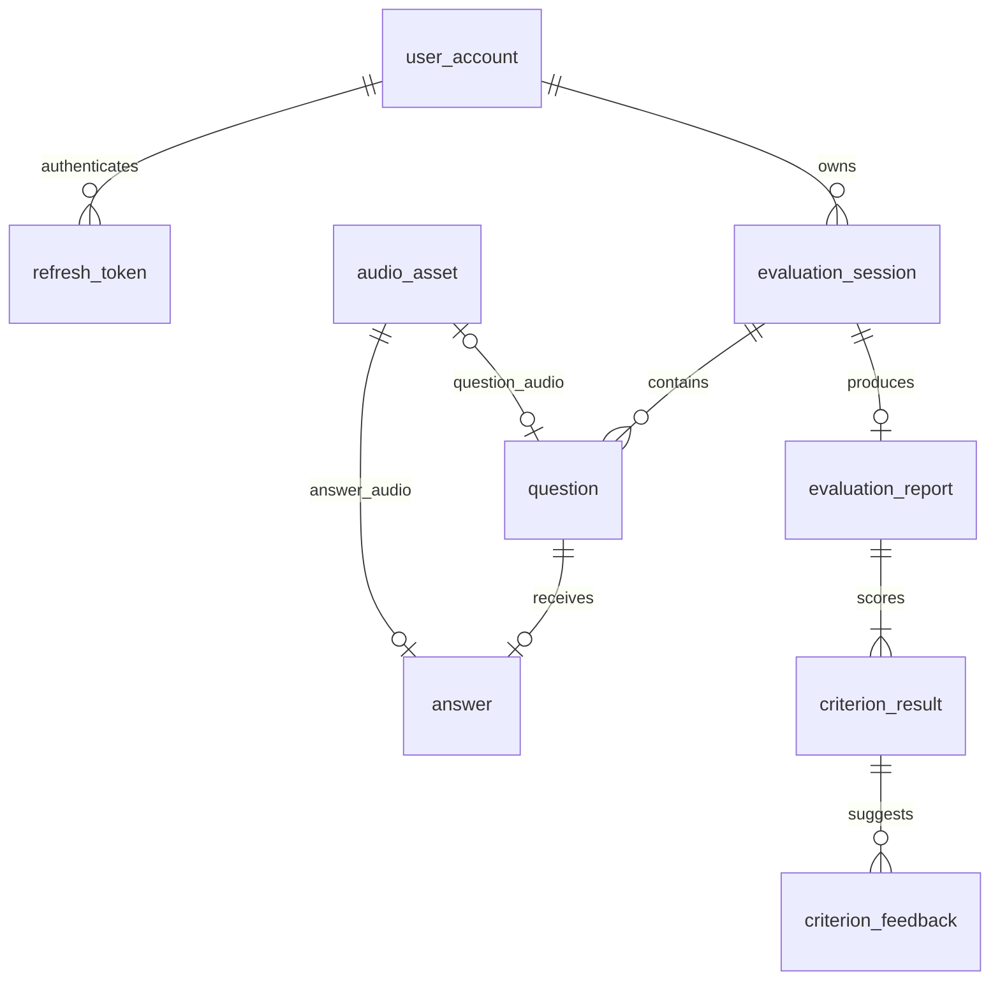

# 영어 회화 평가 플랫폼 — 기본 ERD

수정일: 2026-10-13. 기본 골격 8개에 Refresh Token을 추가한 **9개 테이블**을 유지한다. 전체 타입·키·관계는 [erd.dbml](./erd.dbml)을 따른다. 실제 DB 마이그레이션은 실행하지 않았다.

NULL 허용은 `허용`, 필수는 `불가`로 표시한다. PK는 기본키, FK는 외래키다. 복합 UNIQUE ①은 테이블 아래에 명시한 컬럼 조합 전체의 유일성을 의미한다. 모든 FK는 삭제·갱신 시 RESTRICT다. ENUM 타입은 아래 허용값을 사용한다. 기본값은 별도로 지정하지 않는다.

## 기본 관계

## 회원 계정 (`user_account`)

| 컬럼명(한글) | 컬럼명(영문) | 타입 | NULL 허용 | 제약 |
| --- | --- | --- | --- | --- |
| 회원 ID | `user_id` | `uuid` | 불가 | PK |
| 로그인 ID | `login_id` | `text` | 불가 | UNIQUE; 정규화 후 저장 |
| 비밀번호 해시 | `password_hash` | `text` | 불가 | — |
| 계정 상태 | `account_status` | `account_state` | 불가 | — |
| 현재 평가 수준 | `current_level_code` | `proficiency_level_code` | 허용 | 평가 전 NULL; 최신 확정 평가 수준 |
| 생성 시각 | `created_at` | `timestamptz` | 불가 | — |

## 리프레시 토큰 (`refresh_token`)

| 컬럼명(한글) | 컬럼명(영문) | 타입 | NULL 허용 | 제약 |
| --- | --- | --- | --- | --- |
| 토큰 ID | `token_id` | `uuid` | 불가 | PK |
| 회원 ID | `user_id` | `uuid` | 불가 | FK → user_account(user_id) |
| 토큰 해시 | `token_hash` | `text` | 불가 | UNIQUE; 원문 토큰 저장 금지 |
| 발급 시각 | `created_at` | `timestamptz` | 불가 | 최초 발급 시각 |
| 만료 시각 | `expires_at` | `timestamptz` | 불가 | created_at보다 이후 |
| 폐기 시각 | `revoked_at` | `timestamptz` | 허용 | 유효 토큰은 NULL; 값이 있으면 created_at 이상 |

Access Token은 JWT로 발급하고 DB에 저장하지 않는다. Refresh Token은 암호학적으로 안전한 난수로 생성하고 DB에는 해시만 저장한다. 회원별 토큰은 여러 개 발급할 수 있다.

가입·로그인 시 Access Token과 Refresh Token을 발급한다. 웹 클라이언트의 Refresh Token은 HttpOnly·Secure 쿠키로 전달하며 SameSite 정책과 요청 Origin 검증을 적용한다. 갱신·로그아웃은 POST 요청으로 처리한다. 쿠키 속성·경로는 발급과 삭제 시 일치시킨다.

`auth.refresh`는 토큰 해시, 만료, 폐기 여부와 회원 ACTIVE 상태를 검증한 뒤 새 Access Token과 Refresh Token을 발급한다. 같은 행의 token_hash를 교체하고 created_at·expires_at은 유지해 최초 만료 시각을 연장하지 않는다. 기존 해시 조건의 원자적 갱신과 트랜잭션으로 동시에 들어온 갱신 요청 중 하나만 성공시킨다. 원문 토큰과 해시는 로그에 남기지 않는다.

`auth.logout`은 전달된 Refresh Token을 폐기하고 인증 쿠키·클라이언트 Access Token을 삭제한다. 이미 만료·폐기된 토큰의 로그아웃도 완료로 처리한다. Access Token 만료만으로 로그아웃을 막지 않는다. 이미 발급된 Access Token은 만료까지 유효할 수 있다.

토큰 수명은 서버 설정에서 관리하며 구체적인 값은 미확정이다. 별도 로그인 세션·회전 이력·기기 관리·토큰 재사용 탐지 테이블은 추가하지 않는다. 갱신된 쿠키를 받지 못한 경우 재로그인한다.

## 평가 세션 (`evaluation_session`)

| 컬럼명(한글) | 컬럼명(영문) | 타입 | NULL 허용 | 제약 |
| --- | --- | --- | --- | --- |
| 평가 ID | `evaluation_id` | `uuid` | 불가 | PK |
| 회원 ID | `user_id` | `uuid` | 불가 | FK → user_account(user_id) |
| 시작 수준 | `starting_band_code` | `proficiency_band_code` | 불가 | — |
| 평가 상태 | `status` | `evaluation_status` | 불가 | — |
| 생성 시각 | `created_at` | `timestamptz` | 불가 | — |
| 시작 시각 | `started_at` | `timestamptz` | 허용 | 시작 전 NULL |
| 최근 일시정지 시각 | `paused_at` | `timestamptz` | 허용 | 일시정지 중에만 값 유지 |
| 종료 시각 | `ended_at` | `timestamptz` | 허용 | 종료 전 NULL |

started_at은 값이 있으면 created_at 이상이다. ended_at은 값이 있으면 started_at이 존재하고 그 이상이다.

PAUSED 상태에서만 paused_at이 존재한다. 재개 시 NULL로 초기화한다. 정지 구간 이력은 저장하지 않는다.

## 질문 (`question`)

| 컬럼명(한글) | 컬럼명(영문) | 타입 | NULL 허용 | 제약 |
| --- | --- | --- | --- | --- |
| 질문 ID | `question_id` | `uuid` | 불가 | PK |
| 평가 ID | `evaluation_id` | `uuid` | 불가 | FK → evaluation_session(evaluation_id); 복합 UNIQUE ① |
| 질문 순서 | `question_no` | `integer` | 불가 | 복합 UNIQUE ①; > 0 |
| 질문 내용 | `content` | `text` | 불가 | — |
| 질문 난이도 | `difficulty_level_code` | `proficiency_level_code` | 불가 | — |
| 질문 음성 ID | `audio_id` | `uuid` | 허용 | FK → audio_asset(audio_id); UNIQUE; 음성 생성 전 NULL |
| 생성 시각 | `created_at` | `timestamptz` | 불가 | — |

복합 UNIQUE ①: `(evaluation_id, question_no)`.

질문은 생성된 내용을 확정한 뒤 저장한다. 질문 음성은 audio_id에 직접 연결한다.

## 답변 (`answer`)

| 컬럼명(한글) | 컬럼명(영문) | 타입 | NULL 허용 | 제약 |
| --- | --- | --- | --- | --- |
| 답변 ID | `answer_id` | `uuid` | 불가 | PK |
| 질문 ID | `question_id` | `uuid` | 불가 | FK → question(question_id); UNIQUE |
| 답변 음성 ID | `audio_id` | `uuid` | 불가 | FK → audio_asset(audio_id); UNIQUE |
| 전체 전사문 | `transcript` | `text` | 허용 | 전사 완료 전 또는 실패 시 NULL |
| 처리 상태 | `processing_status` | `answer_processing_status` | 불가 | — |
| 답변 접수 시각 | `accepted_at` | `timestamptz` | 불가 | — |

질문당 답변은 최대 하나다. 전체 전사문은 구간 분리 없이 transcript에 저장한다.

processing_status가 COMPLETED이면 transcript는 NOT NULL이다.

## 음성 자원 (`audio_asset`)

| 컬럼명(한글) | 컬럼명(영문) | 타입 | NULL 허용 | 제약 |
| --- | --- | --- | --- | --- |
| 음성 ID | `audio_id` | `uuid` | 불가 | PK |
| 객체 키 | `object_key` | `text` | 불가 | UNIQUE; 프리픽스를 포함한 전체 객체 키 |
| MIME 타입 | `mime_type` | `text` | 불가 | — |
| 파일 크기(바이트) | `byte_size` | `bigint` | 불가 | > 0 |
| 음성 길이(밀리초) | `duration_ms` | `bigint` | 불가 | > 0 |
| 저장 시각 | `created_at` | `timestamptz` | 불가 | — |

모든 음성은 하나의 고정 버킷에 저장한다. 버킷 이름은 서버 설정에서 관리하며 DB 컬럼으로 저장하지 않는다. 프리픽스는 object_key에 포함하며 별도 컬럼을 두지 않는다.

질문 음성 객체 키 예시: `questions/{question_id}/{audio_id}.mp3`. 답변 음성 객체 키 예시: `answers/{answer_id}/{audio_id}.webm`. 확장자는 실제 음성 형식에 맞춘다. object_key는 버킷 안에서 유일하며 버킷 이름이나 전체 URL을 포함하지 않는다.

음성 파일은 저장 후 불변이다. 같은 음성을 질문과 답변 양쪽에 연결하지 않는다.

## 평가 보고서 (`evaluation_report`)

| 컬럼명(한글) | 컬럼명(영문) | 타입 | NULL 허용 | 제약 |
| --- | --- | --- | --- | --- |
| 보고서 ID | `report_id` | `uuid` | 불가 | PK |
| 평가 ID | `evaluation_id` | `uuid` | 불가 | FK → evaluation_session(evaluation_id); UNIQUE |
| 최종 평가 수준 | `final_level_code` | `proficiency_level_code` | 허용 | 평가 불가인 경우에만 NULL |
| 평가 판정 | `verdict` | `evaluation_verdict` | 불가 | — |
| 종합 평가 설명 | `summary` | `text` | 불가 | — |
| 보고서 생성 시각 | `created_at` | `timestamptz` | 불가 | — |

완료된 보고서만 저장한다. 평가당 보고서는 최대 하나다.

UNASSESSABLE이면 final_level_code는 NULL이고, CONFIRMED 또는 PROVISIONAL이면 NOT NULL이다.

보고서와 5개 항목 결과, 피드백을 같은 트랜잭션으로 저장하고 평가 상태를 COMPLETED로 갱신한다.

기본 적용 규칙: CONFIRMED 보고서만 회원의 current_level_code에 반영한다. 평가 시작 시각이 가장 최근인 확정 평가를 적용하며, 동률이면 보고서 생성 시각과 report_id 순으로 결정한다. 과거 평가의 늦은 완료로 현재 수준을 덮어쓰지 않는다. PROVISIONAL·UNASSESSABLE은 기존 현재 수준을 유지한다.

## 평가 항목 결과 (`criterion_result`)

| 컬럼명(한글) | 컬럼명(영문) | 타입 | NULL 허용 | 제약 |
| --- | --- | --- | --- | --- |
| 항목 결과 ID | `result_id` | `uuid` | 불가 | PK |
| 보고서 ID | `report_id` | `uuid` | 불가 | FK → evaluation_report(report_id); 복합 UNIQUE ① |
| 평가 항목 코드 | `criterion_code` | `assessment_criterion_code` | 불가 | 복합 UNIQUE ① |
| 항목 점수 | `score` | `numeric(8,3)` | 허용 | 부족 사유와 정확히 하나만 값 존재 |
| 평가 데이터 부족 사유 | `insufficient_reason` | `text` | 허용 | 점수와 정확히 하나만 값 존재 |
| 항목 판단 이유 | `rationale` | `text` | 불가 | — |

복합 UNIQUE ①: `(report_id, criterion_code)`.

보고서마다 5개 평가 항목을 각각 한 행으로 저장한다. 점수 범위는 코드의 채점 규칙으로 검증한다.

## 평가 피드백 (`criterion_feedback`)

| 컬럼명(한글) | 컬럼명(영문) | 타입 | NULL 허용 | 제약 |
| --- | --- | --- | --- | --- |
| 피드백 ID | `feedback_id` | `uuid` | 불가 | PK |
| 항목 결과 ID | `result_id` | `uuid` | 불가 | FK → criterion_result(result_id); 복합 UNIQUE ① |
| 피드백 순서 | `feedback_no` | `integer` | 불가 | 복합 UNIQUE ①; > 0 |
| 피드백 종류 | `feedback_kind` | `feedback_kind` | 불가 | — |
| 개선 제안 또는 수정 표현 | `suggestion` | `text` | 불가 | — |
| 제안 이유 | `explanation` | `text` | 불가 | — |

복합 UNIQUE ①: `(result_id, feedback_no)`.

## ENUM 허용값

| 타입 | 허용값 |
| --- | --- |
| `account_state` | `ACTIVE`, `DISABLED` |
| `proficiency_band_code` | `BEGINNER`, `INTERMEDIATE`, `ADVANCED` |
| `proficiency_level_code` | `BEGINNER_LOW`, `BEGINNER_MID`, `BEGINNER_HIGH`, `INTERMEDIATE_LOW`, `INTERMEDIATE_MID`, `INTERMEDIATE_HIGH`, `ADVANCED_LOW`, `ADVANCED_MID`, `ADVANCED_HIGH` |
| `evaluation_status` | `READY`, `IN_PROGRESS`, `PAUSED`, `ENDING`, `ANALYSIS_PENDING`, `ANALYZING`, `COMPLETED`, `ANALYSIS_FAILED` |
| `answer_processing_status` | `PENDING`, `PROCESSING`, `COMPLETED`, `FAILED` |
| `evaluation_verdict` | `CONFIRMED`, `PROVISIONAL`, `UNASSESSABLE` |
| `assessment_criterion_code` | `VOCABULARY`, `GRAMMAR`, `PRONUNCIATION`, `FLUENCY`, `RELEVANCE` |
| `feedback_kind` | `IMPROVEMENT`, `EXPRESSION_CORRECTION` |

평가 항목 표시명은 어휘·문법·발음·유창성·답변 적절성이다. 수준은 초급·중급·고급 각각 하·중·상 9개다. 이름과 판정 규칙은 코드에서 관리한다.

## 기본 처리 규칙

AI 처리는 서버·큐에서 실행하고 필요한 현재 처리 상태는 평가 세션과 답변에 저장한다. 회원의 현재 수준은 조회용 중복 값이며, 평가별 원본 수준은 보고서에 보존한다.

동시 상태 변경과 보고서 생성은 평가 행 잠금과 트랜잭션으로 보호한다. 현재 수준 갱신은 회원 행 잠금 아래 최신 확정 평가 여부를 확인한다. 행 내부 조건은 CHECK, 교차 테이블 조건은 쓰기 경계에서 검증한다. 기존 기능 문서와 구조가 충돌하면 이번 9개 테이블 기본 설계를 우선한다.
